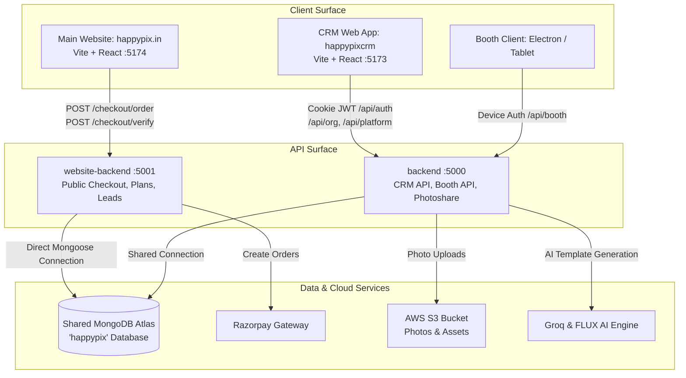
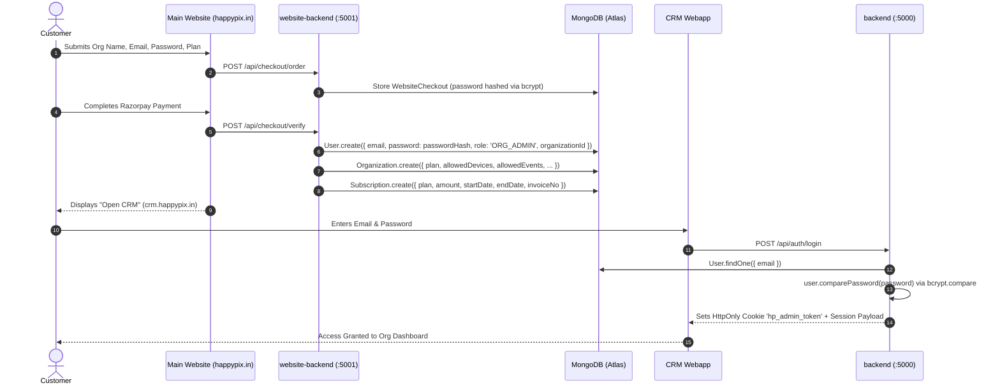

# HAPPYPIX V2 — FULL-STACK ARCHITECTURAL, PLAN & DATABASE AUDIT DOCUMENT
**Document Version:** 2.0.0  
**Prepared For:** HappyPix Engineering & Product Team  
**Role:** Senior Full-Stack MERN Developer & Lead QA Auditor  
**Date:** October 2026  
**Scope:** Main Website (`website` + `website-backend`), Core Backend (`backend`), CRM Frontend (`crm`), Database Models & Connectivity (`MongoDB Atlas`).

---

## EXECUTIVE SUMMARY

HappyPix operates as a multi-tier SaaS and photo-booth hardware/software ecosystem. Clients purchase subscriptions and hardware add-ons via the public-facing website (`happypix.in`). The credentials and organization identity provisioned during purchase must seamlessly power authentication and authorized operations inside the HappyPix CRM (`crm.happypix.in`) and the connected photobooth fleet.

This comprehensive audit investigated:
1. **User Journey & Authentication Pipeline:** From client input on the main website to MongoDB persistence and CRM login.
2. **Subscription Plans & Pricing Integrity:** Verifying plan definitions, pricing calculations, discount campaigns, and add-on seeding.
3. **Plan-Based Feature Enforcement:** Determining whether CRM and booth operations strictly respect purchased plan tiers, device limits, event limits, AI credits, and add-on modules.
4. **Backend-to-Database Data Flow & Omissions:** Identifying missing records, schema discrepancies, unhandled edge cases, and data that should be stored in MongoDB but currently is not.

---

## 1. SYSTEM ARCHITECTURE & TOPOLOGY



### Architectural Risk: Dual-Backend Schema Drift
* `website-backend` (port 5001) and `backend` (port 5000) run as **two independent Node.js processes** connecting to the **same MongoDB URI**.
* `website-backend/src/models.js` duplicates Mongoose schemas from `backend/models/*.js`. 
* **Finding:** Any schema modification made in `backend/models/` without an identical update in `website-backend/src/models.js` creates silent data omissions or validation mismatches.

---

## 2. MAIN WEBSITE CHECKOUT & ONBOARDING AUDIT

### 2.1 Customer Input Fields vs Database Mapping
When a customer selects a plan and checks out on `happypix.in/pricing`, the following payload is submitted to `POST /api/checkout/order`:

| Form Input | Target Mongo Model | Target Field | Status | Data Type | Notes |
| :--- | :--- | :--- | :--- | :--- | :--- |
| `organizationName` | `Organization` | `name` | ✅ Saved | String | Required |
| `ownerName` | `Organization` / `User` | `ownerName` / `name` | ✅ Saved | String | Trimmed |
| `phone` | `Organization` / `User` | `phone` / `phoneNumber` | ✅ Saved | String | Regex validated |
| `email` | `Organization` / `User` | `email` | ✅ Saved | String | Lowercase, unique |
| `password` | `User` | `password` | ⚠️ Saved as Hash | String (Bcrypt) | Hashed at checkout order |
| `planKey` | `Organization` / `Subscription` | `plan` | ✅ Saved | String | Validated against catalogue |
| `billingPeriod` | `Organization` | `billingCycle` | ✅ Saved | Enum ('monthly'/'annual') | Controls term extension |
| `addonKeys` | `Organization` | `addons` | ⚠️ Partially Saved | Array of Objects | Stored in DB, but not enforced |

---

### 2.2 Critical Data That is NOT Going Into the Database (Missing Data Flow)

#### ❌ 1. No Billing Address, State, Pincode or GSTIN
* **Issue:** HappyPix bills customers in Indian Rupees (INR) through Razorpay. For B2B software compliance under Indian GST laws, an invoice must state the buyer's Legal Business Name, Registered Address, State/State Code, and **GSTIN** (if registered).
* **Current State:** Neither `WebsiteCheckout`, `Organization`, nor `Subscription` collects or stores `address`, `city`, `state`, `pincode`, or `gstin`.
* **Impact:** Generated invoices (`invoiceNo: HAP-INV-YYMM-XXXX`) are legally incomplete and cannot provide B2B clients with Input Tax Credit (ITC).

#### ❌ 2. Country Hardcoding
* **Issue:** `activateCheckout` hardcodes `country: 'IN'` and `currency: 'INR'`, despite the website codebase having Australian Dollar (AUD) pricing models and CORS support for `happypix.com.au`.
* **Impact:** International buyers are forcibly assigned Indian localization and Razorpay gateway.

#### ❌ 3. No Terms & Privacy Acceptance Timestamp
* **Issue:** The checkout form does not record an explicit `termsAcceptedAt` or `privacyAcceptedAt` timestamp or IP address.
* **Impact:** Non-compliance with standard digital commerce payment dispute guidelines (chargebacks on Razorpay).

#### ❌ 4. No "Confirm Password" Field on Checkout
* **Issue:** If a new customer accidentally makes a typo in their password during checkout, there is no second confirmation input. The password is immediately hashed and stored.
* **Impact:** The client is locked out of the CRM upon redirect and is forced to initiate an OTP password reset immediately after payment.

---

### 2.3 Critical Payment Failure Vulnerability: Missing Razorpay Webhook
* **Severity:** 🔴 **CRITICAL (Revenue & Account Loss)**
* **Location:** `website-backend/src/routes.js`
* **Vulnerability Analysis:**
  1. The checkout process initiates a Razorpay Order in `POST /api/checkout/order` and stores a temporary `WebsiteCheckout` document with `status: 'created'`.
  2. The actual account creation (`Organization`, `User`, `Subscription`) **only occurs** inside `POST /api/checkout/verify`, which is triggered by the **browser's client-side JavaScript callback**:
     ```javascript
     // website/src/components/Checkout.jsx (lines 70-76)
     handler: async (response) => {
       const result = await verifyPayment(response);
       // only here does activateCheckout get called
     }
     ```
  3. **The Failure Mode:** If the customer pays via UPI/Netbanking on their phone or modal, and:
     - The browser tab is closed immediately upon payment completion,
     - The mobile browser refreshes or loses internet connectivity,
     - Razorpay modal fails to execute the callback script,
  4. **The Result:** The money is deducted from the customer's bank account, but `POST /api/checkout/verify` is never executed. `WebsiteCheckout` remains stuck in `status: 'created'`. **No User account is created, no Organization is created, and the customer cannot log into the CRM.**
* **Remedy:** Implement a server-to-server Razorpay Webhook (`order.paid` / `payment.captured`) in `website-backend` that calls `activateCheckout()` idempotently.

---

## 3. CRM AUTHENTICATION & LOGIN FLOW VERIFICATION

### 3.1 How Credentials Flow Into CRM


### 3.2 Password Hashing Consistency Check
* **In `website-backend/src/routes.js`:**
  ```javascript
  passwordHash = await bcrypt.hash(password, 10);
  ```
* **In `backend/models/User.js`:**
  ```javascript
  userSchema.methods.comparePassword = async function(enteredPassword) {
    return await bcrypt.compare(enteredPassword, this.password);
  };
  ```
* **Verdict:** ✅ **Correct & Compatible.** Both services use standard `bcryptjs` with cost factor `10`. The password stored during checkout cleanly authenticates in the CRM `/api/auth/login` endpoint.

### 3.3 Account Friction: Lack of Cross-Domain Auto-Login (SSO)
* After purchasing, the website displays:
  ```html
  <a href="https://happypixcrm.vercel.app">Open your CRM</a>
  ```
* The user is forced to re-type their email and password manually on the CRM login screen.
* **Recommendation:** Generate a one-time secure login exchange token (`tempLoginToken`) upon checkout verification, allowing `happypixcrm.vercel.app/login?token=xyz` to automatically establish the CRM session without re-prompting.

---

## 4. SUBSCRIPTION PLANS AUDIT (SAHI YA GALAT?)

### 4.1 Plan Comparison Across Codebases

| Plan Key | Name | Website Display Price | Backend Catalog (`planService.js`) | CRM Definitions (`lib/plans.js`) | Included Devices | Included Active Events | AI Credits |
| :--- | :--- | :--- | :--- | :--- | :--- | :--- | :--- |
| `trial` | Trial | ₹0 (14 days) | ₹0 (14 days) | ₹0 (14 days) | 1 | 1 | 0 |
| `basic` | Basic | ₹799/mo (₹5,988/yr) | ₹799/mo (₹5,988/yr) | ₹799/mo | 2 | 2 | 0 |
| `pro` | Pro | ₹999/mo (₹9,588/yr) | ₹999/mo (₹9,588/yr) | ₹999/mo | 2 | 4 | 0 |
| `premium` | Premium | ₹1,299/mo (₹11,988/yr)| ₹1,299/mo (₹11,988/yr)| ₹1,299/mo | 2 | 8 | 500 |
| `custom` | Custom | Contact Sales | null (Custom term) | Price: null | 25 | 20 | 0 |

---

### 4.2 Major Plan Bugs & Discrepancies Discovered

#### 🔴 BUG 1: Add-ons Database Seeding Failure (`ADDON_CATALOG` Omission)
* **Location:** `backend/routes/crm/platform.js` (lines 937–943) vs `backend/services/planService.js` (lines 105–123).
* **The Bug:**
  In `platform.js`:
  ```javascript
  export async function ensurePlanCatalog() {
    for (const plan of DEFAULT_PLAN_CATALOG) {
      const existing = await SubscriptionPlan.findOne({ key: plan.key });
      if (!existing) await SubscriptionPlan.create(plan);
    }
  }
  ```
  `ensurePlanCatalog()` only loops over `DEFAULT_PLAN_CATALOG`. **It never loops over `ADDON_CATALOG`!**
* **The Consequence:**
  When `website-backend` executes:
  ```javascript
  // website-backend/src/routes.js line 81
  const rows = await SubscriptionPlan.find({ active: { $ne: false } }).lean();
  if (rows && rows.length) return rows; // Returns 5 base plans, 0 addons!
  ```
  Because base plans exist, the fallback catalogue is ignored. The returned `addons` array is **EMPTY (`[]`)**! The public website `/api/plans` receives no add-ons from the database.

#### 🟡 BUG 2: Legacy Plan Code Pollution
* **Location:** `backend/models/Organization.js` (lines 4–9) and `backend/routes/eventRoutes.js` (lines 46–51).
* **The Bug:**
  ```javascript
  export const PLAN_DEVICE_LIMITS = {
    starter:      1,
    professional: 3,
    business:     10,
    enterprise:   -1,
  };
  ```
  These reference discontinued plan names (`starter`, `professional`, `business`, `enterprise`). While modern routes rely on `planService.js`, legacy code paths still import these dead objects.

#### 🟡 BUG 3: Data Type Mismatch on Custom Plan Limits
* In `crm/src/lib/plans.js`: `devices: '5–25'`, `events: '5–20'` (Strings).
* In `backend/services/planService.js`: `devices: 25`, `events: 20` (Numbers).
* When the CRM displays usage bars (`used / limit`), string values can produce `NaN%` calculation bugs in UI progress bars.

---

## 5. PLAN-BASED ENFORCEMENT AUDIT IN CRM & BOOTH

Does the CRM and Booth actually enforce features based on the customer's plan?

```
┌───────────────────────────────────────┬───────────────────────────────────────────┐
│ WHAT IS ENFORCED                      │ WHAT IS NOT ENFORCED (MAJOR GAPS)        │
├───────────────────────────────────────┼───────────────────────────────────────────┤
│ ✅ Device Limit (assertDeviceLimit)    │ ❌ AI Template Generation Credits (0 check)│
│ ✅ Active Event Limit (assertEventLimit)│ ❌ Purchased Add-on Modules (0 check)     │
│ ✅ Plan Expiry Write Guard (assertPlanUsable)│ ❌ Analytics & Revenue CRM View Gating │
│ ✅ Suspended Org Read-Only Enforcement│ ❌ Custom Branding Feature Gating         │
│ ✅ Banned Org Immediate Session Kill  │ ❌ 30-Day Cloud Gallery Auto-Pruning     │
└───────────────────────────────────────┴───────────────────────────────────────────┘
```

### 5.1 Deep-Dive: The AI Credits Vulnerability
* **Website Claim:** Basic & Pro plans have 0 AI credits. Premium plan includes 500 AI template credits.
* **Database Field:** `Organization.aiCredits` (set to 500 upon Premium checkout).
* **The Reality in Code (`backend/routes/crm/org.js` lines 1560–1585):**
  ```javascript
  router.post('/ai-generate', requireWritableOrg, aiLimiter, async (req, res) => {
    // ⚠️ ZERO check for req.organization.aiCredits
    // ⚠️ ZERO deduction of aiCredits upon generation
    const aiService = new TemplateGenerationService();
    const result = await aiService.generate(prompt, context);
    res.json(result);
  });
  ```
* **Financial Risk:** Any organization (even on a free 14-day trial or Basic plan) can trigger real FLUX & Groq GPU generation calls indefinitely up to the rate limit. HappyPix incurs API costs while receiving zero subscription revenue.

---

### 5.2 Deep-Dive: Complete Absence of Add-on Enforcement
Customers are charged ₹299/month (or ₹2,999 one-time) for:
1. `addon-headshot` (Professional Headshot Mode)
2. `addon-video` (Video, GIF & Boomerang Booth Mode)
3. `addon-branding` (Custom Start Screen Branding)
4. `addon-survey` (Survey & Lead Capture)
5. `addon-music` (Custom Music & Sound Effects)
6. `addon-props` (Event Props & Frames Pack)

* **Audit Finding:**
  - `website-backend/src/activate.js` writes the purchased add-ons to `Organization.addons`.
  - In `backend/routes/crm/auth.js`: The session endpoint **does not even return `addons`** to the CRM frontend!
  - In `backend/routes/boothRoutes.js`: When a photobooth pulls event configuration and snapshot, **there is zero check for whether the organization owns `addon-video`, `addon-headshot`, etc.**
  - **Verdict:** Either every booth gets access to these features, or legitimate paying customers cannot unlock them. The add-on monetization model is disconnected in software.

---

### 5.3 Deep-Dive: Revenue & Analytics Gating
* **Website Claim:** Business Analytics & Reports are exclusive to the Premium tier.
* **Code State:** `router.get('/revenue', requirePerm(PERMS.ORG_REVENUE_VIEW))` allows any `ORG_ADMIN`, regardless of whether their plan is `trial`, `basic`, `pro`, or `premium`.

---

## 6. BACKEND & DATABASE CONNECTION & DATA FLOW OMISSIONS

### 6.1 Database Models Audit Matrix

| MongoDB Collection | Defined in `backend/` | Mirrored in `website-backend/` | Critical Fields Missing / Discrepant |
| :--- | :---: | :---: | :--- |
| `organizations` | ✅ `Organization.js` | ✅ `models.js` | Missing `billingAddress`, `gstin`, `stateCode`. Enum conflict in `status`. |
| `users` | ✅ `User.js` | ✅ `models.js` | `website-backend` schema lacks pre-save hook (by design for pre-hashed passwords). |
| `subscriptionplans` | ✅ `SubscriptionPlan.js`| ✅ `models.js` | Missing seeded rows for `ADDON_CATALOG`. |
| `subscriptions` | ✅ `Subscription.js` | ✅ `models.js` | Missing tax breakdown (`cgst`, `sgst`, `igst`). |
| `organizationdefaults`| ✅ `OrganizationDefaults.js`| ❌ Not declared | **Never created upon checkout activation!** |
| `websitecheckouts` | ❌ Not declared | ✅ `models.js` | Only owned by website-backend. |
| `websiteleads` | ❌ Not declared | ✅ `models.js` | Only owned by website-backend. |
| `photos` | ✅ `Photo.js` | ❌ Not declared | No TTL index (by design), but no 30-day retention pruning job exists. |

---

### 6.2 The `CronService` Enum Corruption Bug
* **Location:** `backend/services/CronService.js` (lines 18–37) vs `backend/models/Organization.js` (line 62).
* **The Bug:**
  `CronService` executes hourly:
  ```javascript
  await Organization.updateMany(
    { status: 'active', planExpiresAt: { $ne: null, $lt: now } },
    { $set: { status: 'expired' } }
  );
  ```
  However, `backend/models/Organization.js` defines:
  ```javascript
  status: {
    type: String,
    enum: ['active', 'suspended', 'banned'],
    default: 'active',
  }
  ```
* **The Crash:**
  `'expired'` is **NOT** a valid enum value for `Organization.status`! While `updateMany` bypasses Mongoose validation, any subsequent code that loads this organization and executes `await organization.save()` will throw an unhandled:
  ```
  ValidationError: Organization validation failed: status: `expired` is not a valid enum value for path `status`.
  ```
* **Architectural Fix:** `Organization.status` represents tenant operational status (`active`, `suspended`, `banned`). Plan expiry is dynamic and derived via `computePlanStatus(org, subscription)`. `CronService` must never overwrite `status = 'expired'`.

---

### 6.3 Omission of `OrganizationDefaults` on New Account Activation
* When an admin updates layout prices or UPI payout configuration in the CRM, the backend writes to `OrganizationDefaults`.
* In `website-backend/src/activate.js`: When a new customer completes checkout, it creates `Organization`, `User`, and `Subscription`, but **does NOT create `OrganizationDefaults`**.
* Until the customer manually navigates to the Defaults tab in the CRM, no defaults document exists in MongoDB. If a booth device connects immediately after onboarding, fallback chains can encounter `null` reference errors.

---

## 7. MASTER DEFECT LOG & SEVERITY MATRIX

| ID | Module | Defect Description | Severity | Impact |
| :---: | :--- | :--- | :---: | :--- |
| **SEC-01** | Website Backend | No Razorpay Webhook for checkout | 🔴 Critical | Money deducted, no user/org created if browser closes. |
| **CRN-01** | Backend Service | `CronService` sets invalid enum `status: 'expired'` | 🔴 Critical | Causes Mongoose `save()` crashes on expired organizations. |
| **PLN-01** | Platform Backend| `ensurePlanCatalog()` does not seed `ADDON_CATALOG` | 🔴 Critical | Website API returns empty add-ons array (`[]`). |
| **PLN-02** | CRM Backend | AI generation does not check or deduct `aiCredits` | 🟠 High | Free unlimited AI GPU usage on Basic/Trial plans. |
| **PLN-03** | CRM & Booth | Purchased add-on features are never checked/enforced | 🟠 High | Paid add-ons (Video, Headshot, etc.) are non-functional. |
| **DAT-01** | Checkout Data | Missing GSTIN, State Code, and Billing Address | 🟠 High | Tax non-compliance; invalid B2B invoicing in India. |
| **DAT-02** | Activation Flow | `OrganizationDefaults` document not created on checkout | 🟡 Medium | Incomplete initial DB state for new tenants. |
| **PLN-04** | CRM Backend | Revenue & Analytics page not gated to Premium plan | 🟡 Medium | Basic plan users get Premium analytics feature. |
| **UX-01** | Website UI | No "Confirm Password" on checkout form | 🟡 Medium | High customer lockout rate due to undetected typos. |
| **ARC-01** | Codebase | Legacy plan constants in `Organization.js` & `eventRoutes.js` | 🟢 Low | Code debt and developer confusion. |

---

## 8. STEP-BY-STEP REMEDIATION ACTION PLAN

### Phase 1: Immediate Production Hotfixes (Next 24 Hours)
1. **Fix `CronService.js`:** Remove `$set: { status: 'expired' }`. Let `computePlanStatus()` determine expiry dynamically from `Subscription.endDate`.
2. **Fix `ensurePlanCatalog()` in `platform.js`:** Include `ADDON_CATALOG` in the seeding loop so `SubscriptionPlan` collection contains both plans and add-ons.
3. **Implement Razorpay Webhook in `website-backend`:** Add route `POST /api/checkout/razorpay-webhook` listening for `order.paid` to activate checkouts autonomously.

### Phase 2: Feature & Quota Enforcement (Sprint 1)
1. **Enforce AI Credits:**
   - In `/api/org/ai-generate`, check: `if (req.organization.aiCredits < 1) throw forbidden('AI credit balance exhausted.')`.
   - On successful generation, decrement atomically: `await Organization.updateOne({ _id: orgId }, { $inc: { aiCredits: -1 } })`.
2. **Propagate & Enforce Add-ons:**
   - Return `addons` in `/api/auth/me` and `/api/auth/login`.
   - In `boothSnapshotService.js`, verify active add-on keys before enabling Video mode or AI Headshot mode in booth configurations.
3. **Gate Revenue Analytics:**
   - In `/api/org/revenue`, verify `if (plan.key !== 'premium' && plan.key !== 'custom') throw forbidden(...)`.

### Phase 3: Data Completeness & Tax Compliance (Sprint 2)
1. **Update Checkout Form:** Add `gstin`, `billingAddress`, `state`, `pincode`, and a `confirmPassword` input.
2. **Update Database Schemas:** Add `gstin`, `billingAddress` to `Organization` and `Subscription` models across both backends.
3. **Onboarding Initialization:** Call `OrganizationDefaults.create({ organizationId })` inside `activateCheckout()`.

---

## 9. CONCLUSION

The HappyPix V2 codebase possesses strong foundational security patterns (strict origin CORS, HttpOnly JWT cookies, constant-time HMAC verification, and audit logging). However, the **commercial monetization pipeline currently has significant disconnects**:
1. Payments risk being dropped without an asynchronous webhook listener.
2. High-value features (AI generation and Add-ons) are not technically gated or metered against MongoDB plan records.
3. Database status corruption occurs during automated expiration sweeps.

Executing the remediation plan outlined above will align database persistence, plan limits, and financial transactions into an enterprise-ready, reliable SaaS platform.
