# HappyPix — System Diagrams

> **What this is:** the complete diagram set for HappyPix — 29 diagrams covering the ecosystem,
> the database, data flow at three levels, high- and low-level design, and the future architecture.
> **Generated file:** do not edit by hand. The source of truth is `docs/diagrams/src/*.mmd`;
> regenerate with `python3 docs/scripts/build_diagrams.py`.
>
> **Rendering:** every definition is Mermaid. GitHub renders them natively. For a styled, searchable
> viewer open [`docs/diagrams/index.html`](diagrams/index.html) in a browser.

---

## Index

| # | Diagram | Notation | What it answers |
|---|---|---|---|
| 1 | [Complete HappyPix ecosystem — every component and how it connects](#d1-1) | `flowchart` | Solid arrows are request/response over HTTPS or local IPC. An edge label names the protocol or the purpose of the call. |
| 2 | [Trust boundaries, credentials and data ownership](#d1-2) | `flowchart` | This is the security view of the same system: who holds which credential, and which data crosses which boundary. |
| 3 | [ER overview — 23 collections and their foreign keys](#d2-1) | `erDiagram` | Read this first, then open the five detail diagrams. Cardinality is as enforced by the code, not as declared: MongoDB has no real… |
| 4 | [ER detail — identity, tenancy, subscription and configuration](#d2-2) | `erDiagram` | The tenant root is ORGANIZATION. Every organisation-scoped document carries organizationId and every query is pinned to… |
| 5 | [ER detail — events, booths, templates and coupons](#d2-3) | `erDiagram` | EVENT is the unit of booth work; DEVICE.assignedEventId is the single pointer that decides which event a booth is shooting.… |
| 6 | [ER detail — money: payments, subscriptions, coupons and payouts](#d2-4) | `erDiagram` | There is no single "revenue" collection. Payment rows are per booth transaction; Subscription rows are per platform plan… |
| 7 | [ER detail — media, digital delivery and TTL lifecycle](#d2-5) | `erDiagram` | Four collections carry a MongoDB TTL index on expiresAt: PHOTO_SHARE, GUEST_DOWNLOAD, DIGITAL_TOKEN (and the index is declared,… |
| 8 | [ER detail — support, leads and the audit trail](#d2-6) | `erDiagram` | Three different support models exist and none of them is a duplicate: SUPPORT_TICKET is a guest or client ticket raised from a… |
| 9 | [DFD level 0 — context diagram](#d3-0) | `flowchart` | One process, the whole product. Every arrow is a real data flow that crosses the system boundary; none of them is a "management"… |
| 10 | [DFD level 1 — the nine processes of the platform](#d3-1) | `flowchart` | This level is the map of the backend: every mounted router belongs to exactly one of these processes. |
| 11 | [DFD level 2 — process 1.0 booth session](#d3-2) | `flowchart` | The important detail is that the heavy media work happens on the booth, not the server: the API only issues presigned URLs and… |
| 12 | [DFD level 2 — process 2.0 payment and settlement](#d3-3) | `flowchart` | The server is the price authority: the booth asks for a quote, and any amount that does not match the resolved price chain is… |
| 13 | [DFD level 2 — process 3.0 digital delivery](#d3-4) | `flowchart` | Security detail: the guest never receives an S3 URL. They receive an unguessable 144-bit download id, and the API signs… |
| 14 | [DFD level 2 — process 4.0 gallery publishing](#d3-5) | `flowchart` | Publication is a three-way AND: platform gallery policy, guest consent (only if required), and the photo belonging to the… |
| 15 | [DFD level 2 — process 5.0 event and device management](#d3-6) | `flowchart` | Every write here either consumes a plan limit or invalidates a booth snapshot. The revision bump is what makes a change reach the… |
| 16 | [DFD level 2 — process 6.0 tenant onboarding, plans and limits](#d3-7) | `flowchart` | Limits live in exactly one place (services/planService.js). A plan edit in the platform console propagates allowedDevices and… |
| 17 | [DFD level 2 — process 7.0 templates and AI design](#d3-8) | `flowchart` | AI generation is metered: 5 credits per template generation, 1 credit per background removal. Credits are decremented only after… |
| 18 | [DFD level 2 — process 8.0 support handling](#d3-9) | `flowchart` | Two lanes: guest tickets are handled by the organisation; org tickets are handled by HappyPix. A denied platform request can be… |
| 19 | [HLD — the system as four layers plus one control plane](#d4-1) | `flowchart` | The rule that keeps this maintainable: no presentation code contains business rules, and no route contains pricing, permission or… |
| 20 | [HLD — deployment topology, regions and failure domains](#d4-2) | `flowchart` | Three failure domains matter operationally: an Atlas outage stops everything (no request runs without a connection), an S3 outage… |
| 21 | [LLD — the exact request pipeline and middleware order](#d4-3) | `flowchart` | Order is load-bearing. The origin check runs before any body parsing, and the Mongo gate runs after static assets so /uploads… |
| 22 | [LLD — backend module dependency graph](#d4-4) | `flowchart` | Arrows point from caller to callee. Nothing in services/ or utils/ imports a route, which is why the same logic can be reached… |
| 23 | [LLD sequence — device pairing, snapshot and revision sync](#d4-5) | `sequenceDiagram` | The device token is returned exactly once and stored only as a hash. Every later call proves identity with it, and the booth only… |
| 24 | [LLD sequence — checkout, payment, print and download](#d4-6) | `sequenceDiagram` | Two paths reach the same end state: gateway-paid (poll or webhook) and free/offline (quote with finalAmount 0, or a 12-digit… |
| 25 | [LLD sequence — sign-in, session revocation and organisation lifecycle](#d4-7) | `sequenceDiagram` | The sessionVersion integer is the whole revocation mechanism: bumping it on the user or across the organisation invalidates every… |
| 26 | [LLD — booth state machine and front-end structure](#d4-8) | `flowchart` | The booth machine is the contract the UI must follow: no screen can run unless a device token, a snapshot and an active event… |
| 27 | [LLD — front-end application structure and route guards](#d4-9) | `flowchart` | Guards are declarative and derive from the same permission keys the API enforces, so a hidden button and a rejected request… |
| 28 | [Target architecture at full load — what the system must become](#d5-1) | `flowchart` | This is a destination, not a plan for next quarter. It exists so that today's shortcuts are chosen with a known exit: every box… |
| 29 | [Migration roadmap — when each change becomes necessary](#d5-2) | `flowchart` | Each stage is entered by a measurable trigger, not by a date. If the trigger has not fired, the change is premature and adds cost… |

---

## How to read these diagrams

**Flowchart notation used for DFDs** — the same convention at every level:

| Shape | Meaning | Example |
|---|---|---|
| Rectangle | External entity (outside the system boundary) | `Guest`, `Razorpay` |
| Circle / rounded | Process (transforms data) | `2.3 Create payment and order` |
| Cylinder | Data store | `D4 payments` |
| Labelled arrow | Data flow, named as the data itself | `complete quote` |

**ER notation:** `||--o{` is one-to-many, `||--o|` is one-to-zero-or-one, `}o--o{` is many-to-many.
Cardinality describes what the code enforces; MongoDB adds no constraint of its own.

**Sequence diagrams** are ordered by real call order in the code, not by intent. Where the booth
retries or polls, the loop box states the interval used by the shipped apps.

**Connector colours** — the HTML viewer paints every connecting line by what it carries, so a
payment arrow and a Mongo arrow are never the same colour. GitHub shows the same diagrams in the
default Mermaid theme, where connectors stay neutral; open `docs/diagrams/index.html` to see them.

| Colour | Category | Matched from |
|---|---|---|
| Blue | HTTP / API call | the label, or an endpoint-shaped node (`/api/booth/...`) |
| Red | Auth, token, permission | `token`, `login`, `session`, `permission`, `role` |
| Green | MongoDB / data | `MongoDB`, `collection`, `query`, `index`, `TTL index` |
| Amber | S3 / photo media | `S3`, `upload`, `presign`, `photo`, `composite` |
| Purple | Payment, price, plan | `payment`, `order`, `coupon`, `price`, `settlement` |
| Orange | Printing | `print`, `spool`, `IPP`, `DNP`, `paper` |
| Cyan | Async, webhook, TTL | `webhook`, `cron`, `retry`, `poll`, `expiry` |

A connector with no label and no useful endpoint name cycles through the same palette in reading
order, so dense diagrams still trace line by line. `docs/scripts/edge_colors.js` holds the rules —
it is inlined into both HTML viewers at build time, so nothing is fetched at runtime.

---

## 1 · Ecosystem

*Whole-system component and trust maps.*

<sub>Source: `docs/diagrams/src/01-ecosystem.mmd` · 2 diagrams</sub>

<a id="d1-1"></a>

### D1-1 — Complete HappyPix ecosystem — every component and how it connects

> Solid arrows are request/response over HTTPS or local IPC. An edge label names the protocol or the purpose of the call.
>
> Everything inside "HappyPix production platform" is code we deploy. Everything else is a customer site, a guest device, or a third-party provider.

```mermaid
flowchart TB
  subgraph ACT["Actors"]
    A1["Prospect /<br/>website visitor"]
    A2["Guest at<br/>an event"]
    A3["Booth operator"]
    A4["Organization admin<br/>or manager"]
    A5["Platform admin /<br/>support manager"]
    A6["Owner / founder"]
  end

  subgraph CLIENTS["Client applications"]
    C1["Website SPA<br/>React + Vite<br/>happypix.in"]
    C2["CRM console SPA<br/>React + Vite<br/>crm.happypix.in"]
    C3["Electron booth<br/>Windows + macOS<br/>electron/"]
    C4["Android booth<br/>client-app/"]
    C5["Guest phone<br/>browser"]
    C6["Print bridge<br/>printServer.ts"]
  end

  subgraph EDGE["Vercel edge + serverless (bom1 / Mumbai)"]
    E1["CDN + static hosting<br/>3 SPA projects"]
    E2["Main API<br/>Express 5 · /api/*"]
    E3["Website API<br/>Express 5 · /api/*"]
  end

  subgraph CORE["In-process platform services (inside the API functions)"]
    S1["Auth and<br/>permission matrix"]
    S2["Booth snapshot<br/>+ revision engine"]
    S3["Plan and limit<br/>enforcement"]
    S4["Pricing and coupon<br/>engine"]
    S5["Gallery policy<br/>+ signing"]
    S6["Guest download<br/>service"]
    S7["AI template<br/>generation"]
    S8["Delivery service<br/>email, SMS, WhatsApp"]
    S9["CronService<br/>hourly: expiry + cleanup"]
  end

  subgraph DATA["Data stores"]
    D1[("MongoDB Atlas<br/>23 collections")]
    D2[("AWS S3 bucket<br/>photos, logos, artwork")]
    D3[("Local disk uploads/<br/>dev and S3 fallback")]
    D4[("Process caches<br/>gallery 15 s, printer 30 s")]
  end

  subgraph HW["Customer hardware at the venue"]
    H1["DNP dye-sub<br/>photo printer"]
    H2["DSLR or USB<br/>camera"]
    H3["Touchscreen<br/>kiosk display"]
  end

  subgraph EXT["Third-party providers"]
    X1["Razorpay<br/>orders, UPI QR,<br/>payment links"]
    X2["Cashfree<br/>UPI QR orders"]
    X3["SendGrid<br/>OTP and email"]
    X4["Twilio<br/>SMS"]
    X5["WhatsApp<br/>Cloud API"]
    X6["Groq<br/>LLM prompt parsing"]
    X7["Together FLUX<br/>+ xAI<br/>image generation"]
    X8["remove.bg<br/>background removal"]
    X9["GitHub Releases<br/>installers and APKs"]
  end

  A1 --> C1
  A2 --> C5
  A2 --> C3
  A3 --> C3
  A3 --> C4
  A4 --> C2
  A5 --> C2
  A6 --> C2

  C1 -->|"HTTPS: plans, checkout,<br/>downloads, leads"| E3
  C2 -->|"HTTPS + HttpOnly cookie"| E2
  C3 -->|"HTTPS: pair, snapshot,<br/>quote, upload, session"| E2
  C4 -->|"HTTPS: same booth contract"| E2
  C5 -->|"HTTPS: /download/:id"| E3
  C3 -->|"USB / OS spooler"| C6
  C6 -->|"IPP, CUPS,<br/>PowerShell PrintDocument"| H1
  C3 -->|"USB Video / AVFoundation"| H2
  C3 --> H3
  C4 -->|"CameraX<br/>USB or network"| H2
  C4 -->|"IPP / raw socket"| H1

  E1 --> C1
  E1 --> C2
  E2 --> S1
  E2 --> S2
  E2 --> S3
  E2 --> S4
  E2 --> S5
  E2 --> S6
  E2 --> S7
  E2 --> S8
  E2 --> S9
  E3 --> S6
  E3 --> S4

  S1 --> D1
  S2 --> D1
  S2 --> D4
  S3 --> D1
  S4 --> D1
  S5 --> D1
  S5 --> D4
  S6 --> D1
  S6 --> D2
  S7 --> D1
  S8 --> D1
  S9 --> D1
  S9 --> D3
  E2 -->|"presigned PUT<br/>booth uploads directly"| D2
  D2 -->|"presigned GET<br/>1 h gallery, 24 h download"| C5
  D2 -->|"presigned GET"| C2
  D3 --> D2

  S4 -->|"create order,<br/>poll status"| X1
  S4 -->|"create order,<br/>fetch QR"| X2
  X1 -->|"webhook HMAC<br/>payment.captured"| E2
  X2 -->|"webhook HMAC<br/>PAYMENT_SUCCESS"| E2
  S1 -->|"OTP mail"| X3
  S8 --> X3
  S8 --> X4
  S8 --> X5
  S7 --> X6
  S7 --> X7
  S7 --> X8

  CLIENTS -.->|"download and update"| X9
  C2 -->|"subscribe plan via<br/>Razorpay checkout"| E3
```

<a id="d1-2"></a>

### D1-2 — Trust boundaries, credentials and data ownership

> This is the security view of the same system: who holds which credential, and which data crosses which boundary.
>
> A booth holds a device token that is stored server-side only as a SHA-256 hash; organisation gateway secrets are AES-256-GCM encrypted at rest.

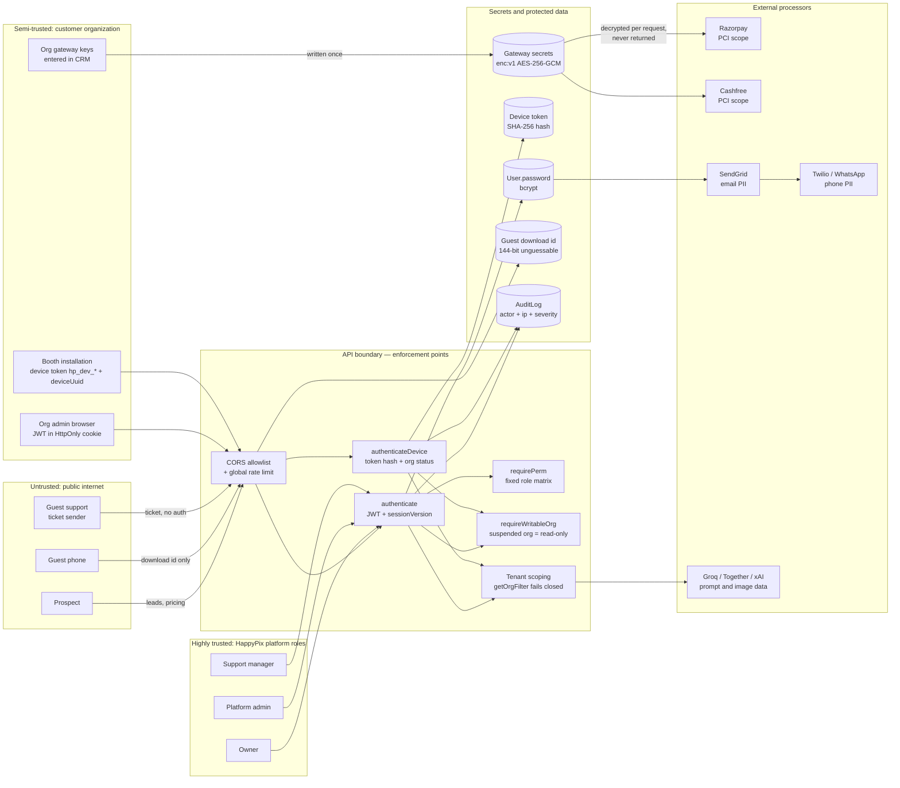

---

## 2 · Database (ER)

*The 23 Mongoose collections and their foreign keys.*

<sub>Source: `docs/diagrams/src/02-er.mmd` · 6 diagrams</sub>

<a id="d2-1"></a>

### D2-1 — ER overview — 23 collections and their foreign keys

> Read this first, then open the five detail diagrams. Cardinality is as enforced by the code, not as declared: MongoDB has no real FK constraints, so every arrow is enforced by an application check.
>
> Three relations are deliberately nullable and matter operationally — AuditLog.organizationId (null = platform scope), Photo.organizationId (null = legacy/unscoped capture) and PhotoShare.organizationId (required only for org-scoped shares).

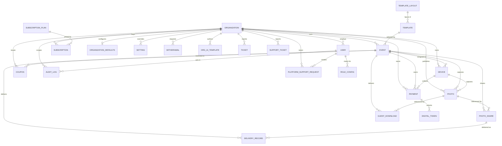

<a id="d2-2"></a>

### D2-2 — ER detail — identity, tenancy, subscription and configuration

> The tenant root is ORGANIZATION. Every organisation-scoped document carries organizationId and every query is pinned to req.organization._id — internal roles are never given an empty filter.
>
> SETTING with organizationId = null is the global row that holds the platform gallery policy, which is why the same collection appears both org-scoped and platform-scoped.

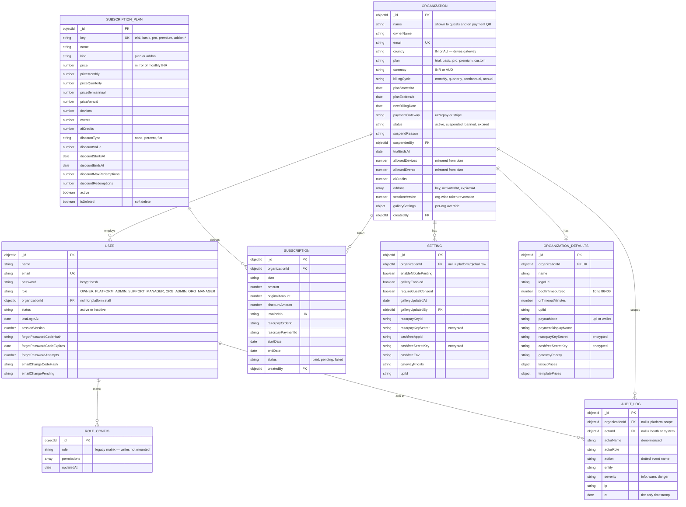

<a id="d2-3"></a>

### D2-3 — ER detail — events, booths, templates and coupons

> EVENT is the unit of booth work; DEVICE.assignedEventId is the single pointer that decides which event a booth is shooting. Deleting an event clears that pointer and detaches coupons.
>
> Event-level gateway keys are overrides of the organisation defaults, which is why the same credential columns exist on both documents.

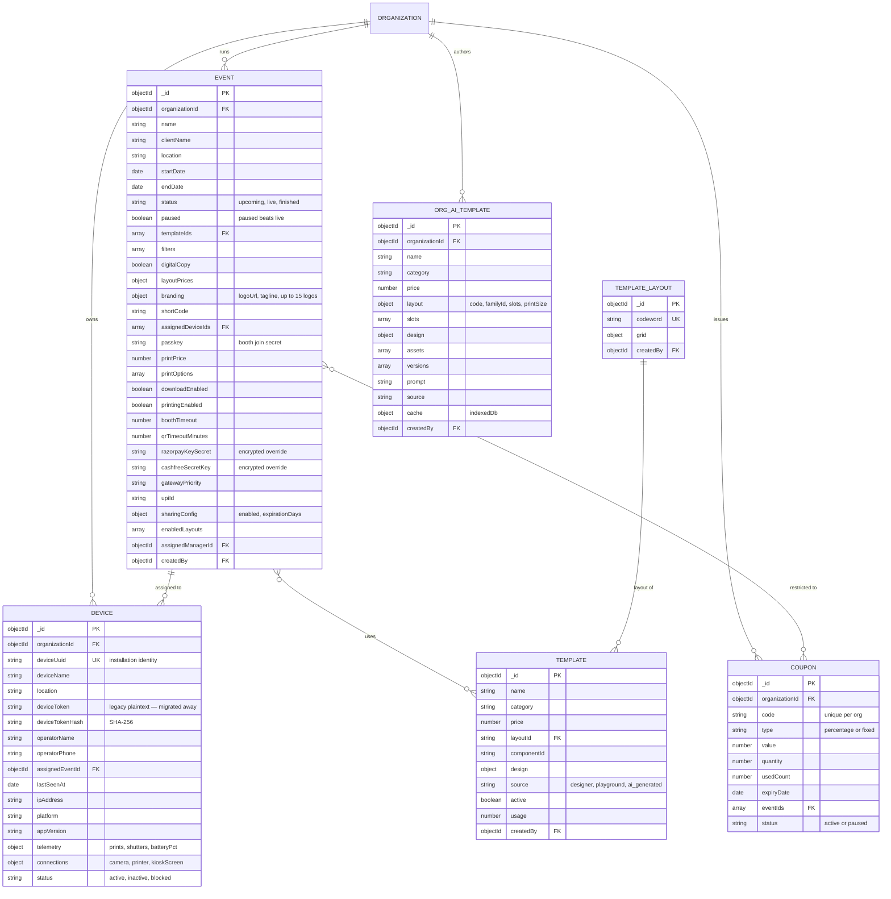

<a id="d2-4"></a>

### D2-4 — ER detail — money: payments, subscriptions, coupons and payouts

> There is no single "revenue" collection. Payment rows are per booth transaction; Subscription rows are per platform plan purchase; Withdrawal rows are organisation payouts from the wallet balance.
>
> Payment.settlement decides whether money goes to the organisation UPI directly or into the HappyPix wallet — the revenue dashboard splits every total on this field.

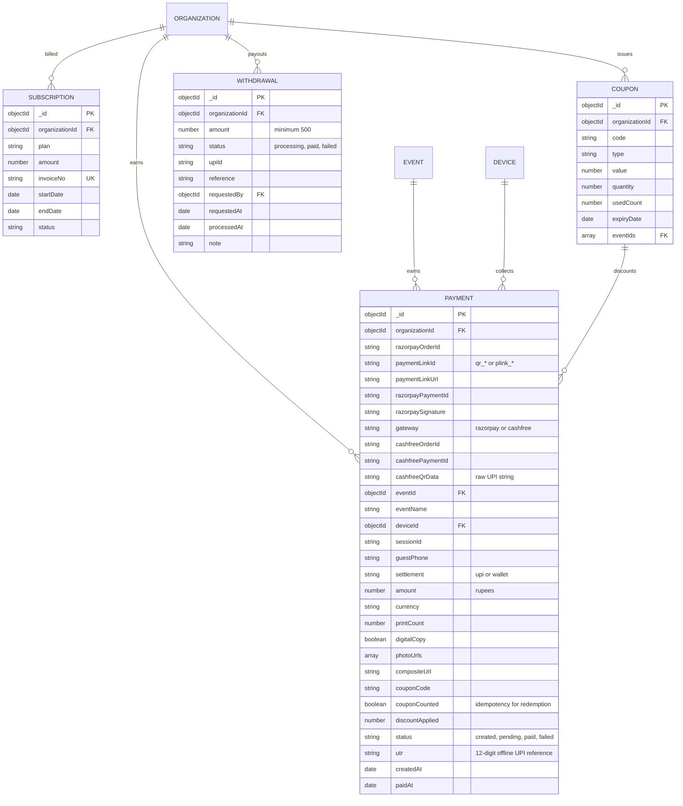

<a id="d2-5"></a>

### D2-5 — ER detail — media, digital delivery and TTL lifecycle

> Four collections carry a MongoDB TTL index on expiresAt: PHOTO_SHARE, GUEST_DOWNLOAD, DIGITAL_TOKEN (and the index is declared, not cron-driven). Data disappears without any application write, so every reader must also check expiry explicitly.
>
> PHOTO has no TTL — photo rows are permanent by design (a legacy TTL index on createdAt is actively dropped at boot). Its URL points at a private bucket, so readers must sign.

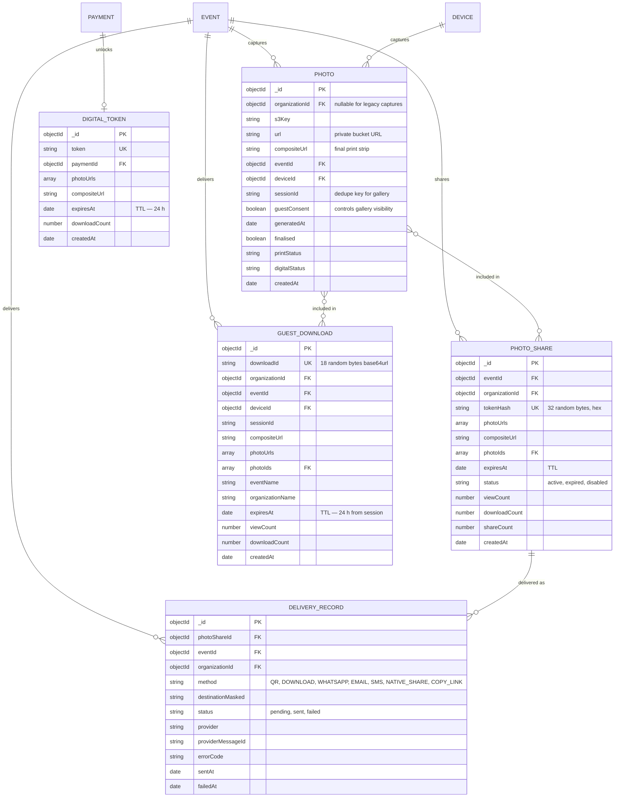

<a id="d2-6"></a>

### D2-6 — ER detail — support, leads and the audit trail

> Three different support models exist and none of them is a duplicate: SUPPORT_TICKET is a guest or client ticket raised from a booth or website, TICKET is the org-side operational ticket, PLATFORM_SUPPORT_REQUEST is the org-to-platform escalation with an accept/deny/apply lifecycle.
>
> AUDIT_LOG is append-only in practice: no route updates or deletes a row, and the actor name and role are denormalised so deleting a user never blanks history.

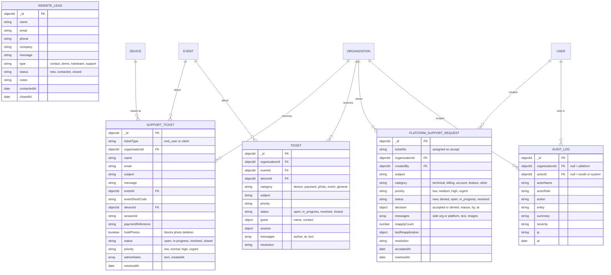

---

## 3 · Data flow (DFD 0/1/2)

*Context, level 1, and one level 2 diagram per business process.*

<sub>Source: `docs/diagrams/src/03-dfd.mmd` · 10 diagrams</sub>

<a id="d3-0"></a>

### D3-0 — DFD level 0 — context diagram

> One process, the whole product. Every arrow is a real data flow that crosses the system boundary; none of them is a "management" arrow.
>
> The two payment gateways are drawn as external entities because money and settlement happen outside HappyPix; we only create orders and read status.

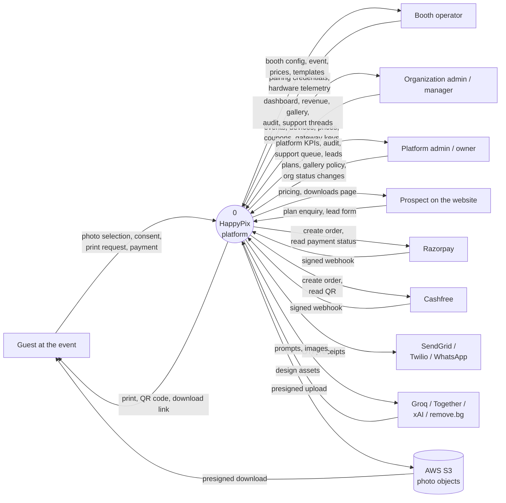

<a id="d3-1"></a>

### D3-1 — DFD level 1 — the nine processes of the platform

> This level is the map of the backend: every mounted router belongs to exactly one of these processes.
>
> Process 9 is cross-cutting — it is drawn as a process because audit writes are an explicit step in every state change, not an implicit side effect.

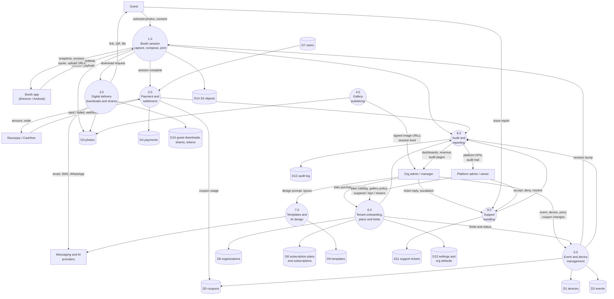

<a id="d3-2"></a>

### D3-2 — DFD level 2 — process 1.0 booth session

> The important detail is that the heavy media work happens on the booth, not the server: the API only issues presigned URLs and writes thin Photo rows.

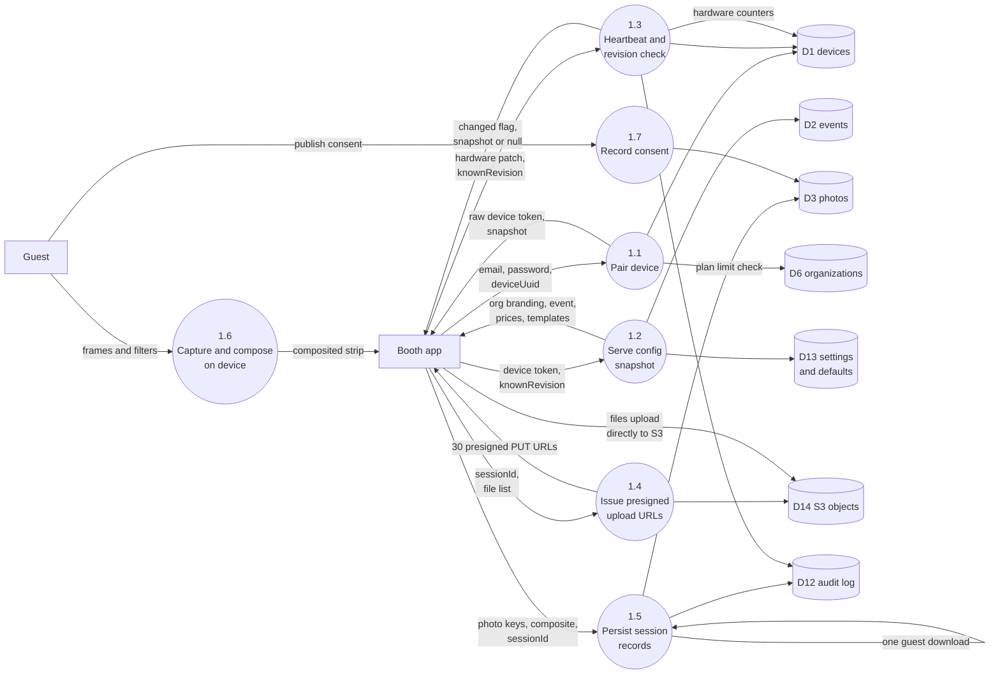

<a id="d3-3"></a>

### D3-3 — DFD level 2 — process 2.0 payment and settlement

> The server is the price authority: the booth asks for a quote, and any amount that does not match the resolved price chain is rejected with PRICE_MISMATCH before an order exists.

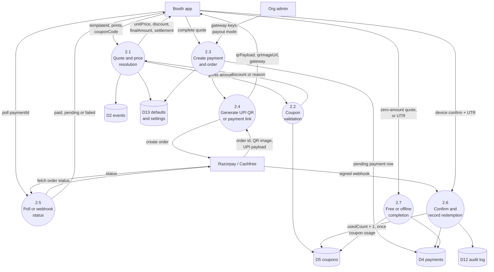

<a id="d3-4"></a>

### D3-4 — DFD level 2 — process 3.0 digital delivery

> Security detail: the guest never receives an S3 URL. They receive an unguessable 144-bit download id, and the API signs short-lived URLs only after checking expiry.

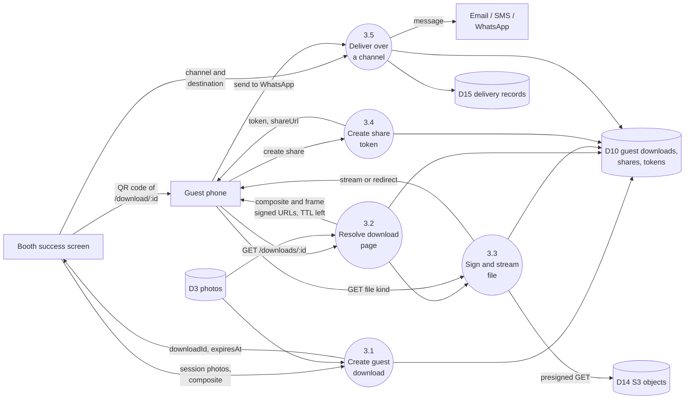

<a id="d3-5"></a>

### D3-5 — DFD level 2 — process 4.0 gallery publishing

> Publication is a three-way AND: platform gallery policy, guest consent (only if required), and the photo belonging to the organisation. Any one being false hides the photo.

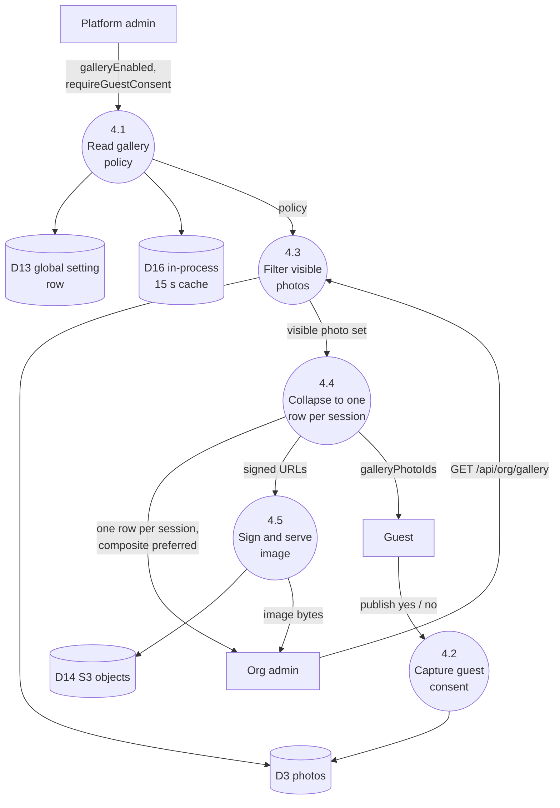

<a id="d3-6"></a>

### D3-6 — DFD level 2 — process 5.0 event and device management

> Every write here either consumes a plan limit or invalidates a booth snapshot. The revision bump is what makes a change reach the fleet without polling every booth.

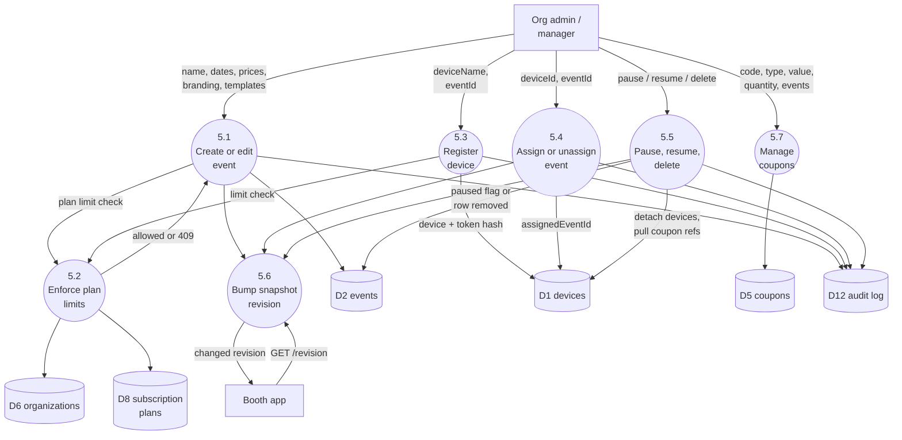

<a id="d3-7"></a>

### D3-7 — DFD level 2 — process 6.0 tenant onboarding, plans and limits

> Limits live in exactly one place (services/planService.js). A plan edit in the platform console propagates allowedDevices and allowedEvents to every organisation on that plan key.

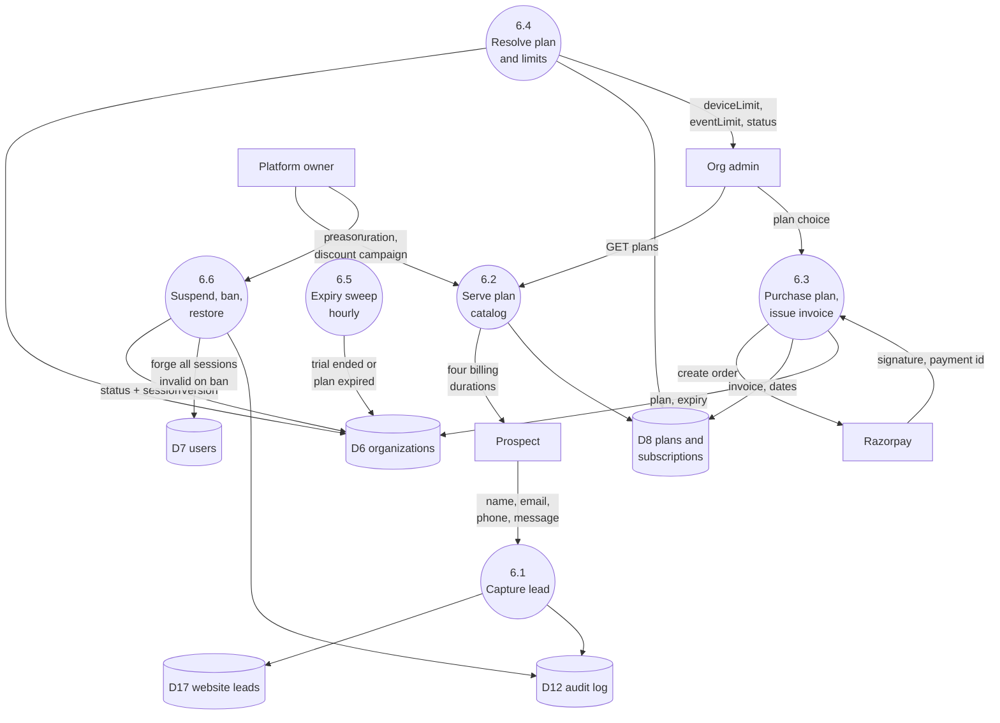

<a id="d3-8"></a>

### D3-8 — DFD level 2 — process 7.0 templates and AI design

> AI generation is metered: 5 credits per template generation, 1 credit per background removal. Credits are decremented only after a successful provider response.

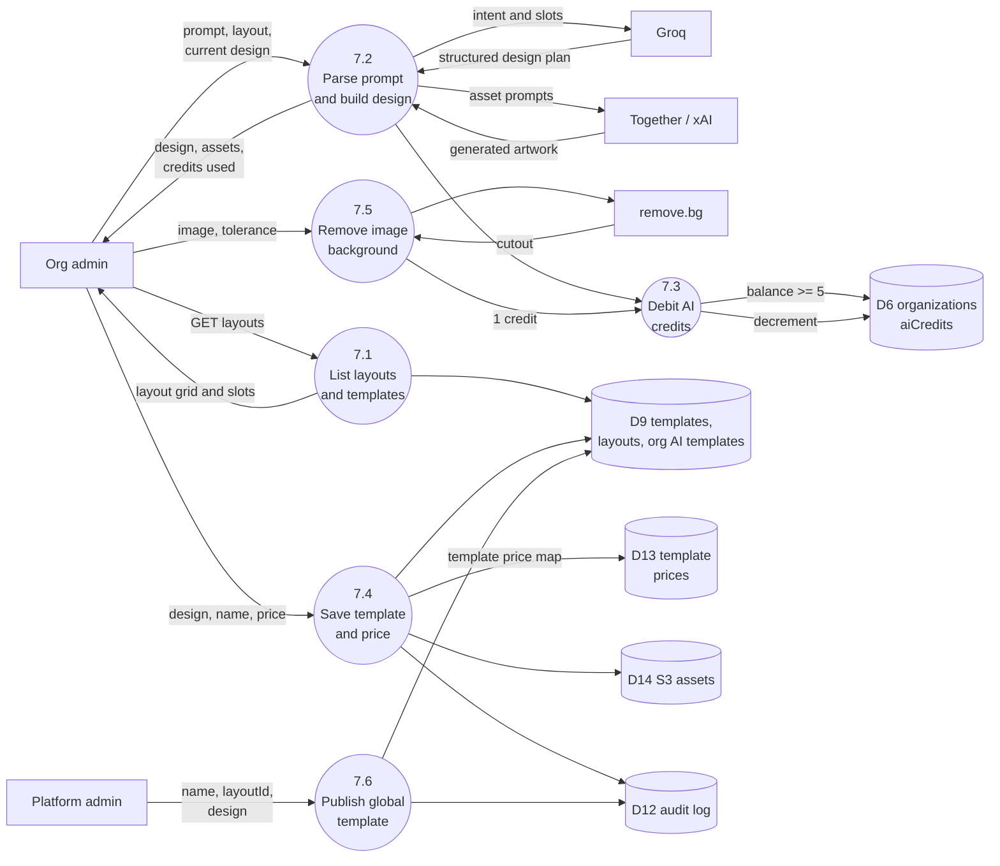

<a id="d3-9"></a>

### D3-9 — DFD level 2 — process 8.0 support handling

> Two lanes: guest tickets are handled by the organisation; org tickets are handled by HappyPix. A denied platform request can be re-applied, which resets the ticket number and clears the decision.

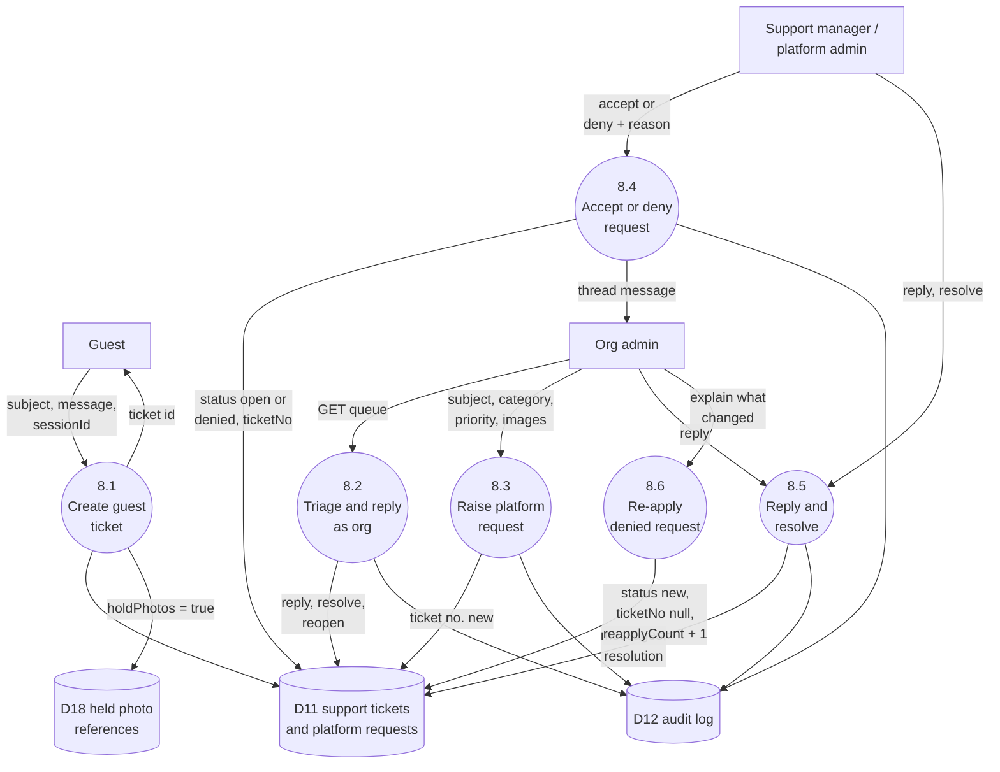

---

## 4 · HLD / LLD

*Layered architecture, deployment, request pipeline, sequences, state machine.*

<sub>Source: `docs/diagrams/src/04-hld-lld.mmd` · 9 diagrams</sub>

<a id="d4-1"></a>

### D4-1 — HLD — the system as four layers plus one control plane

> The rule that keeps this maintainable: no presentation code contains business rules, and no route contains pricing, permission or limit logic — those three always come from a shared module.
>
> The control plane (right column) is not a separate deployment; it is the same API and database, filtered by role.

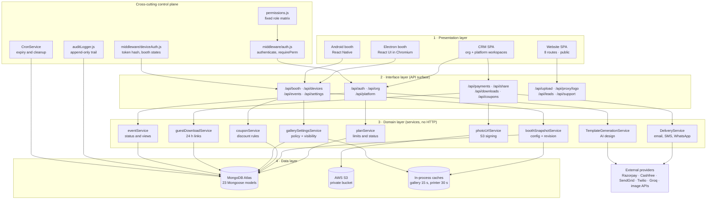

<a id="d4-2"></a>

### D4-2 — HLD — deployment topology, regions and failure domains

> Three failure domains matter operationally: an Atlas outage stops everything (no request runs without a connection), an S3 outage only breaks images and uploads, and a gateway outage blocks checkout but not capture and printing.

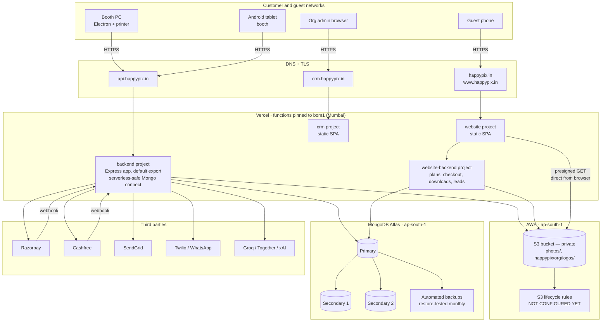

<a id="d4-3"></a>

### D4-3 — LLD — the exact request pipeline and middleware order

> Order is load-bearing. The origin check runs before any body parsing, and the Mongo gate runs after static assets so /uploads keeps working during a database incident.
>
> Rate limiters are per-scope: global 1200/15 min, then per-route limiters on leads, pairing, OTP, coupons, gallery delivery, AI and downloads.

```mermaid
flowchart TB
  A0["Incoming request"] --> A1["Security headers<br/>nosniff, DENY frame, HSTS in prod"]
  A1 --> A2["globalLimiter<br/>1200 requests / 15 min / IP"]
  A2 --> A3["cors origin function<br/>5 static + env + dev + vercel pattern"]
  A3 --> A4{"Origin allowed?"}
  A4 -->|"no"| A5["403 CORS_FORBIDDEN"]
  A4 -->|"yes or no Origin header"| A6["express.json 50 mb<br/>captures req.rawBody"]
  A6 --> A7["cookieParser<br/>hp_admin_token"]
  A7 --> A8["express.static /uploads<br/>local asset fallback"]
  A8 --> A9["Request logger"]
  A9 --> A10["GET / health string"]
  A10 --> A11["connectDB gate<br/>awaits cached Atlas connection"]
  A11 -->|"fail"| A12["503 Database unavailable"]
  A11 --> A13{"Route mount"}
  A13 --> A14["/api/auth → crm/auth.js<br/>+ authLimiter, OTP limiters"]
  A13 --> A15["/api/org → crm/org.js<br/>router.use authenticate + authorize"]
  A13 --> A16["/api/platform → crm/platform.js<br/>router.use authenticate + requirePerm"]
  A13 --> A17["/api/booth → boothRoutes.js<br/>soft or strict device auth"]
  A13 --> A18["/api/payments → paymentRoutes.js"]
  A14 --> B1["authenticate<br/>cookie, bearer or query token"]
  B1 --> B2["jwt.verify HS256<br/>12 h TTL"]
  B2 --> B3["Load user, strip password<br/>compare sessionVersion"]
  B3 --> B4{"sessionVersion equal?"}
  B4 -->|"no"| B5["401 SESSION_REVOKED"]
  B4 -->|"yes"| B6{"user.status active?"}
  B6 -->|"no"| B7["403 ACCOUNT_DEACTIVATED"]
  B6 -->|"yes"| B8["normalise role<br/>attach permissions"]
  B8 --> B9{"organizationId?"}
  B9 -->|"yes"| B10["Load org<br/>banned → 403 + bumpSessionVersion"]
  B10 --> B11["suspended → req.orgReadOnly = true"]
  B9 -->|"no"| B12["platform scope"]
  B11 --> C1["requirePerm<br/>roleHasPermission"]
  B12 --> C1
  C1 -->|"deny"| C2["403 FORBIDDEN_PERMISSION"]
  C1 -->|"allow"| C3{"write route?"}
  C3 -->|"yes"| C4["requireWritableOrg<br/>403 ORG_SUSPENDED"]
  C3 -->|"no"| C5["Handler"]
  C4 --> C5
  C5 --> D1["Domain service"]
  D1 --> D2["Mongoose model"]
  D2 --> D3["JSON response"]
  C5 -->|"throws"| D4["asyncRoute → HttpError"]
  D4 --> D5["Global error handler<br/>5xx message masked in prod"]
  A17 --> E1["resolveDevice<br/>token hash, uuid match"]
  E1 --> E2{"device state"}
  E2 -->|"unpaired"| E3["401 UNPAIRED"]
  E2 -->|"deleted"| E4["410 DEVICE_DELETED"]
  E2 -->|"blocked"| E5["403 DEVICE_BLOCKED"]
  E2 -->|"org suspended"| E6["403 SUSPENDED"]
  E2 -->|"org banned"| E7["403 BANNED"]
  E2 -->|"active"| E8["boothStateFor + requireOperationalBooth"]
  E8 --> E9{"plan expired?"}
  E9 -->|"yes"| E10["402 PLAN_EXPIRED"]
  E9 -->|"no"| C5
```

<a id="d4-4"></a>

### D4-4 — LLD — backend module dependency graph

> Arrows point from caller to callee. Nothing in services/ or utils/ imports a route, which is why the same logic can be reached from a booth route, a CRM route and a cron job.

```mermaid
flowchart LR
  subgraph ROUTES["routes/"]
    RA["crm/auth.js"]
    RO["crm/org.js"]
    RP["crm/platform.js"]
    RB["boothRoutes.js"]
    RE["eventRoutes.js"]
    RY["paymentRoutes.js"]
    RD["downloadRoutes.js"]
    RS["photoShareRoutes.js"]
    RC["couponRoutes.js"]
    RG["settingRoutes.js"]
    RU["supportRoutes.js"]
    RV["deviceRoutes.js"]
  end

  subgraph MW["middleware/"]
    MA["auth.js"]
    MD["deviceAuth.js"]
  end

  subgraph SVC["services/"]
    SP["planService"]
    SB["boothSnapshotService"]
    SC["couponService"]
    SG["gallerySettingsService"]
    SD["guestDownloadService"]
    SU["photoUrlService"]
    SE["eventService"]
    SL["DeliveryService"]
    ST["TemplateGenerationService"]
    SX["backgroundRemovalService"]
    SZ["CronService"]
    SAI["ai/ providers"]
  end

  subgraph UTIL["utils/"]
    UA["auditLogger"]
    UC["crypto"]
    UH["httpError"]
    US["s3"]
    UP["printHelper"]
  end

  subgraph MODELS["models/ — 23"]
    M1["User, Organization,<br/>OrganizationDefaults, Setting"]
    M2["Event, Device, Template,<br/>TemplateLayout, OrgAiTemplate"]
    M3["Payment, Coupon, Subscription,<br/>SubscriptionPlan, Withdrawal"]
    M4["Photo, PhotoShare, DigitalToken,<br/>GuestDownload, DeliveryRecord"]
    M5["SupportTicket, Ticket,<br/>PlatformSupportRequest, WebsiteLead"]
    M6["AuditLog, RoleConfig"]
  end

  CFG["config/<br/>permissions.js · layouts.js"]

  RA --> MA
  RA --> SP
  RA --> UA
  RO --> MA
  RO --> SP
  RO --> SE
  RO --> SC
  RO --> SG
  RO --> SU
  RO --> ST
  RO --> SX
  RO --> UA
  RP --> MA
  RP --> SP
  RP --> SG
  RP --> UA
  RB --> MD
  RB --> SB
  RB --> SC
  RB --> SD
  RB --> SP
  RB --> SE
  RB --> SG
  RB --> US
  RB --> UA
  RE --> MD
  RE --> SE
  RE --> SB
  RY --> MD
  RY --> SC
  RY --> UP
  RY --> UC
  RD --> SU
  RS --> SL
  RS --> MD
  RV --> MD
  RV --> SP
  RV --> SB
  RC --> MD
  RC --> SC
  RG --> SG
  RG --> SB
  RU --> MD
  MA --> CFG
  MA --> UC
  MA --> M1
  MD --> UC
  MD --> SB
  MD --> M1
  SP --> M3
  SB --> SG
  SB --> SU
  SB --> M1
  SD --> M4
  SU --> US
  SL --> M4
  ST --> SAI
  SZ --> M1
  UA --> M6
  RO --> M2
  RO --> M4
  RB --> M4
  RA --> M3
```

<a id="d4-5"></a>

### D4-5 — LLD sequence — device pairing, snapshot and revision sync

> The device token is returned exactly once and stored only as a hash. Every later call proves identity with it, and the booth only refetches configuration when the revision string changes.

```mermaid
sequenceDiagram
  autonumber
  participant OP as Operator
  participant BO as Booth app
  participant API as Main API
  participant DB as MongoDB
  participant S3 as S3

  OP->>BO: enter org email, password, device name
  BO->>API: POST /api/booth/login
  API->>DB: User.findOne role in ORG_ADMIN, ORG_MANAGER
  API->>API: bcrypt.compare password
  API->>DB: Organization.findById
  API->>API: boothStateFor — banned or suspended
  API->>DB: Device.findOne deviceUuid + organizationId
  alt new installation
    API->>DB: countDocuments devices, assertDeviceLimit
    API->>DB: Device.create with SHA-256 token hash
  else re-pair
    API->>DB: rotate deviceTokenHash, save
  end
  API->>DB: load event, defaults, settings, gallery policy
  API->>API: buildBoothSnapshot + computeRevision
  API-->>BO: installation token, snapshot, state ACTIVE
  BO->>BO: persist token in OS keystore and snapshot in IndexedDB
  loop every 10 s while idle
    BO->>API: GET /api/booth/revision
    API->>DB: read device, event, defaults
    API-->>BO: revision, serverTime
    alt revision changed
      BO->>API: GET /api/booth/bootstrap
      API->>DB: full snapshot read
      API-->>BO: snapshot with new revision
      BO->>BO: replace cached config, reload templates
    end
  end
  loop every 30 s during a session
    BO->>API: POST /api/booth/heartbeat with hardwarePatch and knownRevision
    API->>API: mergeHardware — accept only changed fields
    API->>DB: update lastSeenAt, ip, telemetry, connections
    API-->>BO: changed, snapshot or null, canOperate
  end
  Note over BO,API: network failure is a client state, never a server response
  BO->>BO: keep operating from cache, queue uploads locally
```

<a id="d4-6"></a>

### D4-6 — LLD sequence — checkout, payment, print and download

> Two paths reach the same end state: gateway-paid (poll or webhook) and free/offline (quote with finalAmount 0, or a 12-digit UTR). Both create exactly one paid Payment row and one guest download.

```mermaid
sequenceDiagram
  autonumber
  participant G as Guest
  participant BO as Booth app
  participant API as Main API
  participant GW as Razorpay / Cashfree
  participant DB as MongoDB
  participant S3 as S3

  G->>BO: choose template and print count
  BO->>API: POST /api/booth/checkout/quote
  API->>DB: event, templates, org defaults
  API->>API: resolveTemplateUnitPrice event to org to platform
  API->>DB: Coupon.findOne, applyCoupon
  API-->>BO: unitPrice, gross, discount, finalAmount, settlement
  alt finalAmount is 0
    BO->>API: POST /api/booth/checkout/free-complete
    API->>DB: Payment.create status paid, settlement wallet
    API->>DB: recordCouponRedemption once
    API-->>BO: paymentId
  else paid
    BO->>API: POST /api/booth/payments with full quote
    API->>DB: Payment.create status pending
    API->>API: resolveGatewayConfig event to settings to defaults
    API->>GW: orders.create or PGCreateOrder
    GW-->>API: order id
    API->>GW: qrCode.create or PGOrderFetchQRCode
    GW-->>API: QR image URL or UPI payload
    API-->>BO: paymentId, qrPayload, qrImageUrl, gateway
    BO->>G: render QR, start 5 min countdown
    loop every 3 s
      BO->>API: GET /api/booth/payments/:id
      API->>GW: fetch order or QR status
      GW-->>API: status
      API-->>BO: paid, pending or failed
    end
    GW-->>API: signed webhook payment.captured
    API->>DB: Payment.updateOne status paid, paidAt
    API->>DB: Coupon usedCount + 1
  end
  BO->>API: POST /api/booth/sessions/upload-urls
  API-->>BO: presigned PUT URLs, 900 s
  BO->>S3: PUT frames and composite directly
  BO->>API: POST /api/booth/sessions/complete
  API->>DB: Photo.create per file, compositeUrl on all rows
  API->>DB: GuestDownload.create 24 h TTL
  API-->>BO: shareUrl, downloadId, galleryPhotoIds
  BO->>G: print strip, show QR of the download page
  G->>API: GET /api/downloads/:id
  API->>S3: presign composite and frames
  API-->>G: signed URLs, expiresAt
```

<a id="d4-7"></a>

### D4-7 — LLD sequence — sign-in, session revocation and organisation lifecycle

> The sessionVersion integer is the whole revocation mechanism: bumping it on the user or across the organisation invalidates every previously issued token without a session store.

```mermaid
sequenceDiagram
  autonumber
  participant U as User browser
  participant CRM as CRM SPA
  participant API as Main API
  participant DB as MongoDB
  participant PA as Platform admin

  U->>CRM: email and password
  CRM->>API: POST /api/auth/login
  API->>DB: User.findOne email
  API->>API: bcrypt compare, status active
  API->>DB: Organization.findById when org user
  alt organization banned
    API->>DB: audit login blocked
    API-->>CRM: 403 ORG_BANNED
  else allowed
    API->>DB: lastLoginAt = now
    API->>API: issueToken id, role, org, ver
    API-->>CRM: token plus Set-Cookie hp_admin_token HttpOnly
    API-->>CRM: permissions, organization, readOnly flag
  end
  CRM->>API: GET /api/auth/me on every reload
  API->>DB: reload user and compare sessionVersion
  alt mismatch
    API-->>CRM: 401 SESSION_REVOKED
  else match
    API-->>CRM: session payload with permissions
  end
  PA->>API: POST /api/platform/organizations/:id/ban
  API->>DB: Organization.status = banned
  API->>DB: User.updateMany sessionVersion + 1
  API->>DB: Organization.sessionVersion + 1
  API-->>PA: ok
  Note over U,API: next request from any user of that org returns 401 SESSION_REVOKED, then 403 ORG_BANNED on retry
  PA->>API: POST /api/platform/organizations/:id/suspend
  API->>DB: status suspended, reason, suspendedAt
  Note over U,API: users can still sign in read-only, booths are locked and answer 403 SUSPENDED
  U->>API: POST /api/auth/password
  API->>DB: password hash, sessionVersion + 1
  API-->>U: new token, other sessions invalidated
  U->>API: POST /api/auth/logout
  API->>DB: sessionVersion + 1
  API-->>U: clear cookie
```

<a id="d4-8"></a>

### D4-8 — LLD — booth state machine and front-end structure

> The booth machine is the contract the UI must follow: no screen can run unless a device token, a snapshot and an active event exist. Offline is a first-class state, not an error path.

```mermaid
flowchart TB
  S0(("Boot")) --> S1["Load token from<br/>keystore"]
  S1 --> S2{"token present?"}
  S2 -->|"no"| S3["Pairing screen<br/>email + password<br/>+ device name"]
  S3 -->|"POST /api/booth/login"| S4["Persist token<br/>and snapshot"]
  S2 -->|"yes"| S5["GET /api/booth/bootstrap"]
  S5 -->|"active"| S6{"event assigned<br/>and live?"}
  S5 -->|"suspended, banned,<br/>deleted, blocked"| S7["Locked screen<br/>shows exact reason<br/>and code"]
  S4 --> S6
  S6 -->|"no"| S8["Waiting screen<br/>revision polling"]
  S8 -->|"revision changed"| S5
  S6 -->|"yes"| S9["Attract screen<br/>org + event branding"]
  S9 -->|"guest touches"| S10["Entry screen<br/>org name, logo, event,<br/>template logos, event type"]
  S10 -->|"Start Session"| S11["Capture<br/>N shots per layout"]
  S11 --> S12["Photo selection<br/>filter and retake"]
  S12 --> S13["Customize<br/>stickers, text, layout"]
  S13 --> S14["Checkout<br/>quote, QR, countdown"]
  S14 -->|"paid or free"| S15["Upload<br/>presigned PUT to S3"]
  S15 -->|"session complete"| S16["Print<br/>copies per payment"]
  S16 --> S17["Success<br/>download QR,<br/>raise-issue action"]
  S17 -->|"issue raised"| S18["POST /api/booth/support<br/>ticket created"]
  S17 -->|"timeout"| S9
  S18 --> S9
  S14 -->|"gateway failure"| S19["Payment error<br/>retry or pay-at-desk"]
  S19 --> S14
  S15 -->|"network down"| S20["Offline queue<br/>retry with backoff"]
  S20 --> S15
```

<a id="d4-9"></a>

### D4-9 — LLD — front-end application structure and route guards

> Guards are declarative and derive from the same permission keys the API enforces, so a hidden button and a rejected request always agree.

```mermaid
flowchart LR
  subgraph WS["Website — happypix.in"]
    W1["/ Home"]
    W2["/booth /software<br/>/hardware"]
    W3["/pricing"]
    W4["/business /contact"]
    W5["/download/:id<br/>guest page"]
  end

  subgraph CR["CRM — crm.happypix.in"]
    L["/login"]
    OG{"role guard<br/>permission keys"}
    O1["Dashboard"]
    O2["Events and devices"]
    O3["Revenue and wallet"]
    O4["Coupons"]
    O5["Gallery"]
    O6["Templates and AI"]
    O7["Defaults<br/>gateway, UPI, prices"]
    O8["Team"]
    O9["Support tickets"]
    O10["Platform support"]
    O11["Audit"]
    P1["Organizations"]
    P2["Subscription plans"]
    P3["Gallery policy"]
    P4["Platform team"]
    P5["Support queue"]
    P6["Global templates"]
    P7["Template layouts"]
    P8["Website leads"]
    P9["Platform audit"]
  end

  W1 --> W2
  W1 --> W3
  W1 --> W4
  W5 -->|"GET /api/website/downloads/:id"| API["website-backend"]
  L --> OG
  OG -->|"ORG_ADMIN or ORG_MANAGER"| O1
  OG --> O2
  OG --> O6
  OG --> O9
  OG -->|"ORG_ADMIN only"| O3
  O3 --> O4
  O3 --> O8
  O3 --> O11
  OG --> O5
  OG --> O7
  OG --> O10
  OG -->|"OWNER, PLATFORM_ADMIN,<br/>SUPPORT_MANAGER"| P1
  P1 --> P2
  P1 --> P3
  P1 --> P5
  P1 --> P6
  P1 --> P7
  P1 -->|"OWNER only"| P4
  P1 -->|"OWNER only"| P8
  P1 --> P9
  O1 --> API2["Main API<br/>/api/org/*"]
  P1 --> API3["Main API<br/>/api/platform/*"]
```

---

## 5 · Future architecture

*The target state at full load and the measurable triggers to get there.*

<sub>Source: `docs/diagrams/src/05-future.mmd` · 2 diagrams</sub>

<a id="d5-1"></a>

### D5-1 — Target architecture at full load — what the system must become

> This is a destination, not a plan for next quarter. It exists so that today's shortcuts are chosen with a known exit: every box here can absorb the same API contract the booths already speak.
>
> Three structural changes define the jump: the request path becomes stateless containers behind a gateway, post-session work leaves the request path entirely, and photos are served through a CDN instead of the API.

```mermaid
flowchart TB
  subgraph EDGE["Edge layer"]
    G1["Anycast DNS +<br/>TLS termination"]
    G2["WAF + bot rules<br/>+ per-tenant quotas"]
    G3["CDN for static apps<br/>and signed media"]
  end

  subgraph CLIENT["Clients (unchanged contracts)"]
    C1["Electron booth<br/>offline-first,<br/>signed config manifests"]
    C2["Android booth"]
    C3["CRM console"]
    C4["Website"]
    C5["Guest phone"]
  end

  subgraph GATE["API tier — stateless containers, autoscaled"]
    A1["api-in · public reads<br/>snapshot, revision, quote"]
    A2["api-money · payments<br/>webhooks, settlement"]
    A3["api-org · CRM reads and writes"]
    A4["api-platform · admin"]
    A5["Session cache<br/>Redis"]
  end

  subgraph BUS["Asynchronous backbone"]
    B1["Event bus<br/>SQS or Kafka"]
    B2["Media workers<br/>variants, EXIF strip,<br/>composite verification"]
    B3["Notification workers<br/>email, SMS, WhatsApp"]
    B4["AI workers<br/>queued generation,<br/>credit ledger"]
    B5["Webhook workers<br/>gateway retries,<br/>idempotency keys"]
    B6["Report workers<br/>nightly aggregates"]
  end

  subgraph DATA["Data tier"]
    D1[("MongoDB sharded<br/>by organizationId / region")]
    D2[("Read replicas<br/>per region")]
    D3[("Sessions index<br/>one row per booth session")]
    D4[("S3 with lifecycle<br/>hot, IA, Glacier, delete")]
    D5[("Redis<br/>plans, policy, snapshots")]
    D6[("Warehouse<br/>ClickHouse or BigQuery")]
    D7[("Data lake<br/>S3 + Athena")]
  end

  subgraph OPS["Operations plane"]
    O1["OpenTelemetry traces<br/>per request and job"]
    O2["Metrics + SLOs<br/>p95, error budget"]
    O3["Centralised logs<br/>30 day hot retention"]
    O4["Feature flags<br/>per org rollout"]
    O5["Secrets manager<br/>KMS envelope encryption"]
    O6["Cost attribution<br/>per org: storage, AI, egress"]
    O7["Backup and DR<br/>RPO 15 min, RTO 1 h"]
  end

  subgraph EXT["Providers"]
    X1["Razorpay / Cashfree<br/>route by success rate"]
    X2["SendGrid, Twilio,<br/>WhatsApp BSP"]
    X3["LLM and image APIs<br/>multi-vendor fallback"]
  end

  C1 --> G1
  C2 --> G1
  C3 --> G1
  C4 --> G1
  C5 --> G1
  G1 --> G2
  G2 --> A1
  G2 --> A2
  G2 --> A3
  G2 --> A4
  G3 --> C5
  G3 --> C3
  A1 --> A5
  A2 --> A5
  A3 --> A5
  A1 --> D1
  A2 --> D1
  A3 --> D1
  A4 --> D1
  D1 --> D2
  D1 --> D3
  A1 --> G3
  A2 --> B1
  A3 --> B1
  B1 --> B2
  B1 --> B3
  B1 --> B4
  B1 --> B5
  B1 --> B6
  B2 --> D4
  B2 --> D3
  B3 --> X2
  B4 --> X3
  B5 --> X1
  B6 --> D6
  D4 --> D7
  D3 --> D6
  A1 --> O1
  A2 --> O1
  B2 --> O1
  O1 --> O2
  O1 --> O3
  A1 --> O4
  A2 --> O5
  D4 --> O6
  D1 --> O7
  X1 -->|"webhook"| A2
  B5 -->|"retry with<br/>idempotency"| X1
```

<a id="d5-2"></a>

### D5-2 — Migration roadmap — when each change becomes necessary

> Each stage is entered by a measurable trigger, not by a date. If the trigger has not fired, the change is premature and adds cost without removing risk.
>
> Stage 4 is a different company shape (multi-region, dedicated platform team); the honest answer for a single founder is to stop at stage 3 and sell depth instead of volume.

```mermaid
flowchart LR
  subgraph NOW["Today — single region, single API"]
    N1["Vercel serverless<br/>3 SPA projects"]
    N2["MongoDB Atlas<br/>single replica set"]
    N3["S3 private bucket<br/>no lifecycle"]
    N4["In-process caches<br/>and hourly cron"]
    N5["Manual deploys,<br/>no staging"]
  end

  subgraph S1["Stage 1 — 10,000 orgs"]
    A1["Add S3 lifecycle<br/>and image variants"]
    A2["Mongo M40 + alerts<br/>+ restore drills"]
    A3["Error tracking and<br/>structured logs"]
    A4["CI: typecheck, lint,<br/>backend test suite"]
    A5["Staging environment<br/>with separate bucket"]
  end

  subgraph S2["Stage 2 — 100,000 orgs"]
    B1["Redis for plans,<br/>policy, snapshots"]
    B2["Sessions index<br/>one row per session"]
    B3["Queue for media,<br/>notifications, AI"]
    B4["CDN in front of S3"]
    B5["Heartbeat coalescing<br/>60 s per device"]
    B6["Per-org cost<br/>attribution"]
  end

  subgraph S3["Stage 3 — 1,000,000 orgs"]
    C1["Containers instead<br/>of serverless"]
    C2["Shard by tenant<br/>region"]
    C3["Read replicas and<br/>read-preference routing"]
    C4["Warehouse for<br/>revenue and usage"]
    C5["Multi-gateway routing<br/>by success rate"]
    C6["SLOs and error<br/>budgets per service"]
  end

  subgraph S4["Stage 4 — 10,000,000 orgs"]
    D1["Multi-region active<br/>active with data residency"]
    D2["Event-sourced<br/>payment ledger"]
    D3["Dedicated media<br/>pipeline with GPU pool"]
    D4["Self-serve onboarding<br/>and billing automation"]
    D5["Security certifications<br/>SOC 2, ISO 27001"]
  end

  T1{"Trigger:<br/>p95 > 800 ms<br/>or DB CPU > 60 %"}
  T2{"Trigger:<br/>storage > 5 TB<br/>or egress > 20 TB/mo"}
  T3{"Trigger:<br/>booths > 2,000<br/>or 429s appear"}
  T4{"Trigger:<br/>regions > 2<br/>or p95 cross-region > 300 ms"}

  NOW --> T1
  T1 -->|"yes"| S1
  S1 --> T2
  T2 -->|"yes"| S2
  S2 --> T3
  T3 -->|"yes"| S3
  S3 --> T4
  T4 -->|"yes"| S4
```

---

## Keeping these current

| When this changes | Update this file | Why |
|---|---|---|
| A new router, service or external provider | `01-ecosystem.mmd`, `04-hld-lld.mmd` | The component and dependency maps must list it |
| A Mongoose model or a new reference | `02-er.mmd` | ER diagrams are the data contract |
| A new endpoint with new inputs/outputs | `03-dfd.mmd` | The owning process must show the new flow |
| Pricing, plans, gateway behaviour | `03-dfd.mmd` (processes 2.0 and 6.0) | Money flows are the most-read diagrams |
| An infrastructure migration | `04-hld-lld.mmd`, `05-future.mmd` | Deployment truth must match reality |
| A hosting, cost or scale-threshold decision | `04-hld-lld.mmd`, `05-future.mmd` | Keep them in step with [`HOSTING_AND_SCALING.md`](HOSTING_AND_SCALING.md) |

Companion references that read alongside these diagrams:

* [`HOSTING_AND_SCALING.md`](HOSTING_AND_SCALING.md) — where each component actually runs today, its unit
  cost, the numeric triggers that force a move, and the stages from 10K to 10M users. The deployment parts
  of `04-hld-lld` and all of `05-future` are the visual form of that document; if they disagree, the doc wins
  and the diagram is wrong.
* [`BACKEND_REFERENCE.html`](BACKEND_REFERENCE.html) — the full endpoint, middleware, service and model
  reference, including the request-lifecycle and dependency diagrams that are too detailed to belong here.
* [`ARCHITECTURE.md`](ARCHITECTURE.md) — the prose version of `d4-1` and `d4-2`.

Validate after editing (catches Mermaid syntax errors before a reviewer does):

```bash
npm install --no-save mermaid@11 jsdom      # one-off, not committed
node docs/scripts/validate_diagrams.mjs     # prints OK/FAIL per diagram
python3 docs/scripts/build_diagrams.py      # regenerate this file + the viewer
```
