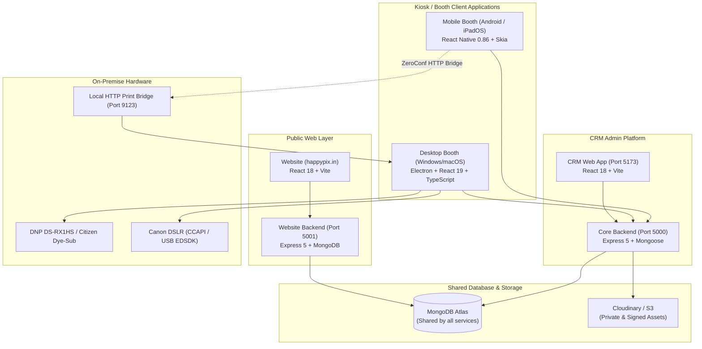
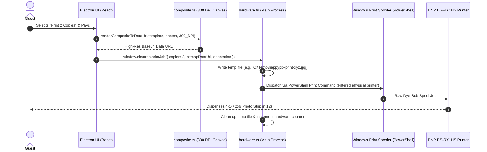
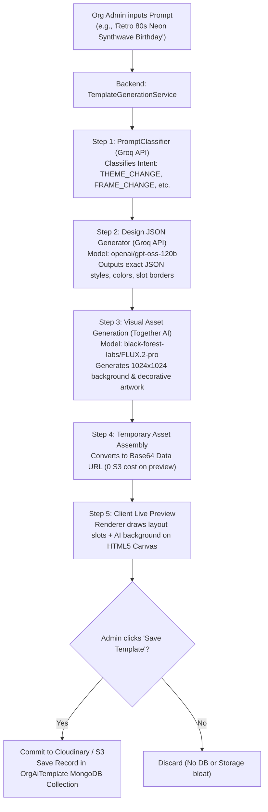
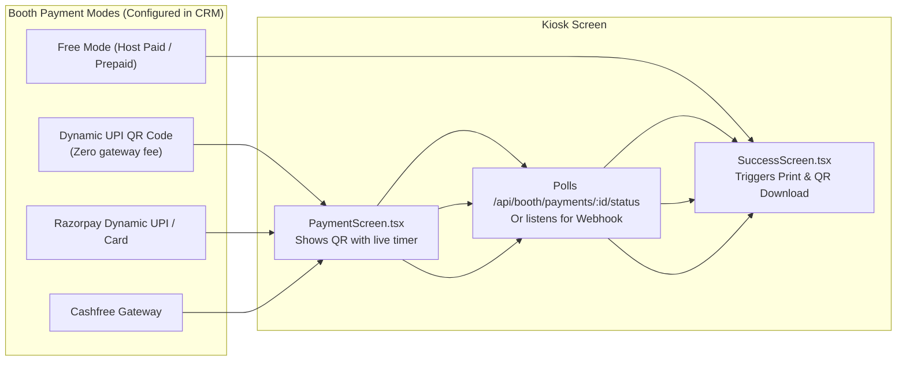
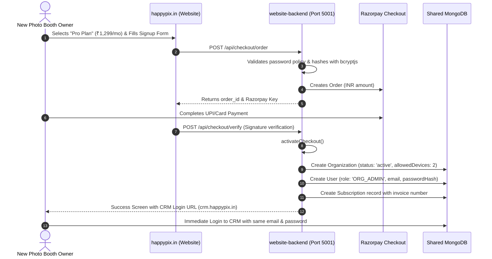

# HappyPix V2 — System Architecture, Role Matrix & Operating Guide

A comprehensive, production-grade guide to the **HappyPix V2 Photo Booth Ecosystem**. This document details all system layers, data flows, hardware integrations, role boundaries, AI and custom template pipelines, security protocols, and operational commands.

---

## Table of Contents
1. [High-Level System Overview & Tech Stack](#1-high-level-system-overview--tech-stack)
2. [Electron Booth App: Architecture, Syntax & Operation](#2-electron-booth-app-architecture-syntax--operation)
3. [Template & Background Photo Flow (CRM → Electron)](#3-template--background-photo-flow-crm--electron)
4. [Hardware & Printing Pipeline (Physical & Digital Print)](#4-hardware--printing-pipeline-physical--digital-print)
5. [CRM Platform: Technology, Architecture & Syntax](#5-crm-platform-technology-architecture--syntax)
6. [CRM Role & Permissions Matrix (Owner, Admins, Managers)](#6-crm-role--permissions-matrix)
7. [Template Layout Engine (Codewords & Mathematical Geometry)](#7-template-layout-engine-codewords--mathematical-geometry)
8. [AI Template Studio (Groq LLM + Together AI FLUX Pipeline)](#8-ai-template-studio-groq-llm--together-ai-flux-pipeline)
9. [Custom Template Engine & Cutout Studio (Canvas + Cutouts)](#9-custom-template-engine--cutout-studio)
10. [Events & Multi-Platform Device Pairing (Android, iOS, Electron)](#10-events--multi-platform-device-pairing)
11. [Payment Gateways & Offline/Online Checkout Flow](#11-payment-gateways--offlineonline-checkout-flow)
12. [Owner Operations: Organization Governance & Subscriptions](#12-owner-operations-organization-governance--subscriptions)
13. [Public Website: Registration, Instant Onboarding & CRM Sync](#13-public-website-registration--instant-onboarding)
14. [Digital Photo Flow, Session Isolation & Guest Privacy](#14-digital-photo-flow-session-isolation--guest-privacy)
15. [Website Leads Management](#15-website-leads-management)
16. [API Keys, Third-Party Integrations & Real-World Pricing](#16-api-keys-third-party-integrations--pricing)
17. [Android & iOS Native Apps: What Works vs. Limitations](#17-android--ios-native-apps-capabilities--limitations)
18. [Run Commands Cheat-Sheet & Startup Scripts](#18-run-commands-cheat-sheet)
19. [Detailed Code-Level Walkthrough (Function-by-Function & Snippets)](#19-detailed-code-level-walkthrough-function-by-function--snippets)

---

## 1. High-Level System Overview & Tech Stack



---

## 2. Electron Booth App: Architecture, Syntax & Operation

### 2.1 Language and Framework
- **Runtime**: **Electron 44.4.3** with **Node.js** execution environment in the main process.
- **Language**: **TypeScript (~5.9.3)** across both main and renderer processes.
- **Frontend / Renderer**: **React 19.2.0**, bundled using **Vite 7.3.1**.
- **Packaging / Distributable**: **Electron-Builder 26.15.3** (compiles to `.exe` for Windows x64, `.dmg`/`.app` for macOS Apple Silicon, `.AppImage` for Linux).

### 2.2 Project Structure & Syntax Style
The app is strictly decoupled using Electron’s secure 3-tier architecture:
1. **Main Process (`electron/src/electron/main.ts`)**:
   - Manages OS native window (`BrowserWindow`), app lifecycle, kiosk full-screen lockdown (`setKiosk(true)`), auto-launch, sleep prevention (`powerSaveBlocker`), native hardware interaction, and OS-level printer spooling.
   - Syntax: Pure TypeScript / Node.js standard modules (`node:fs/promises`, `node:child_process`, `node:os`, `node:http`).
2. **Preload Script (`electron/src/electron/preload.cts`)**:
   - Secure bridge utilizing Electron's `contextBridge.exposeInMainWorld('electron', { ... })`.
   - Prevents `nodeIntegration` leaks into the DOM. Exposes strictly typed APIs like `electron.print()`, `electron.hardwareSnapshot()`, `electron.probeCanon()`, `electron.onKioskExit()`.
3. **Renderer Process (`electron/src/ui/`)**:
   - Modern React 19 Single Page App using Hooks (`useState`, `useEffect`, `useContext`, `useCallback`).
   - State managed by a centralized `BoothContext` (`BoothContext.tsx`).
   - Renders touch-optimized kiosk UI screens: `IdleScreen`, `ChoiceScreen`, `CameraScreen`, `CustomizeScreen`, `PaymentScreen`, `SuccessScreen`.

---

## 3. Template & Background Photo Flow (CRM → Electron)

### 3.1 How the Template Reaches the Booth
1. **Assignment in CRM**:
   The Organization Admin creates an Event (`EventsDevices.jsx`) and selects one or more Templates from the library.
2. **Booth Login & Pairing**:
   The booth connects using an installation token or credentials (`api.login(...)`).
3. **Booth Snapshot API (`/api/booth/snapshot`)**:
   The backend's `boothSnapshotService.js` compiles a single authoritative snapshot for that specific device and event:
   - Event metadata, countdown timers, branding logos, pricing rules.
   - Active templates with their exact slot geometries (x, y, width, height, aspect ratio, rotation).
   - Content `revision` hash (MD5 fingerprint). The booth checks this during periodic heartbeats; it only re-downloads templates when an admin changes something in CRM.
4. **Local Offline Caching (`cache.ts` & IndexedDB)**:
   The Electron app stores the template payload in IndexedDB and local storage. If internet connection drops during an event, the booth continues functioning 100% offline.

### 3.2 How Background Photos & Overlay Graphics Arrive
1. When a template is saved in CRM (AI or Custom), its assets (background canvas, transparent frame PNGs, stickers, cutout overlays) are stored on Cloudinary / S3.
2. The snapshot returns high-resolution asset URLs.
3. In `TemplateCanvas.tsx` / `composite.ts`, the Electron renderer pre-caches and loads these images into memory via HTML5 Image objects:
   ```typescript
   const bgImg = new Image();
   bgImg.crossOrigin = 'anonymous';
   bgImg.src = template.backgroundUrl;
   ```
4. During rendering, the template engine performs a layered draw on an HTML5 `<canvas>`:
   - **Layer 0 (Bottom)**: Background color or generated background artwork.
   - **Layer 1 (Photos)**: Guest photos captured by camera, scaled and clipped (`ctx.drawImage`) into each slot coordinate.
   - **Layer 2 (Overlays)**: Transparent foreground frames, decorative stickers, and cutouts.
   - **Layer 3 (Branding Footer)**: Bottom 15% contains event sponsor logos, host monogram, and event date/tagline.

---

## 4. Hardware & Printing Pipeline (Physical & Digital Print)

### 4.1 Physical Printing from Electron
Physical printing supports heavy-duty dye-sublimation photo printers (such as **DNP DS-RX1HS**, **Citizen CY-02**, **HiTi P525L**).



#### Windows Native Dispatch Logic:
In `hardware.ts`, Electron queries physical printers using `Get-CimInstance Win32_Printer` and ignores virtual PDF/OneNote drivers. It executes a silent PowerShell print spool without prompting dialog boxes:
```typescript
await execAsync(`powershell -NoProfile -NonInteractive -EncodedCommand ${b64Command}`);
```

#### Embedded HTTP Print Bridge (`printServer.ts`):
Electron runs a zero-dependency HTTP server on port `9123`.
- Mobile devices (Android/iOS tablets) on the same Wi-Fi discover this bridge via **mDNS / ZeroConf**.
- When an iPad or Android tablet takes a photo, it sends a `POST http://<pc-ip>:9123/api/print` containing the composite bitmap.
- The Electron PC prints the mobile job to the connected DNP printer instantly.

---

### 4.2 Digital Print (QR Code & Instant Downloads)
Digital delivery works without requiring guests to install an app or login.

1. **Composite Generation**: A digital composite (PNG/JPG) is rendered on canvas.
2. **Session Completion (`/api/booth/complete-session` or `/complete-prepaid`)**:
   The booth uploads the guest photo(s) and composite to Cloudinary via `uploadQueue.ts`.
3. **Cryptographic Token Creation**:
   The backend creates a random UUID token (`DigitalToken` schema) with a strict 24-hour expiration time:
   ```javascript
   const token = crypto.randomUUID();
   const expiresAt = new Date(Date.now() + 24 * 60 * 60 * 1000);
   const digitalToken = new DigitalToken({ token, paymentId, photoUrls, compositeUrl, expiresAt });
   await digitalToken.save();
   ```
4. **QR Code Display**:
   The booth displays an on-screen QR Code encoding:
   `https://happypix.in/download/<token>`
5. **Guest Download**:
   The guest scans the QR with their smartphone. The website verifies the token, displays the high-res composite, individual raw photos, and provides a 1-tap **"Save to Camera Roll"** or WhatsApp share link.

---

## 5. CRM Platform: Technology, Architecture & Syntax

### 5.1 Language and Framework
- **Runtime & Tools**: Modern ES Modules (`type: module`), **React 18.3.1**, **Vite 5.4.11**.
- **Routing**: Lightweight client-side custom hash/history router (`crm/src/lib/router.jsx`) with strict role-based guard middleware.
- **Styling**: Pure semantic responsive CSS (`index.css`) with light/dark theme variables (`crm/src/lib/theme.js`).
- **Data Visualizations**: Custom SVG chart components (`charts.jsx`).

### 5.2 Purpose & Core Functions
The CRM acts as the multi-tenant control plane for:
- Platform Owners & Admins (SaaS governance, global templates, tenant billing, audit logs).
- Tenant Organizations (Wedding planners, photo booth hire companies, corporate event managers).
- Device fleet monitoring (heartbeats, paper remaining, camera battery, online/offline status).
- Event configuration, template customization, coupon codes, and revenue payouts.

---

## 6. CRM Role & Permissions Matrix

HappyPix V2 uses a strict **Role-Based Access Control (RBAC)** model defined in `crm/src/lib/roles.js` and enforced by `backend/middleware/auth.js`.

| Capability / Resource | Owner | Platform Admin | Support Manager | Organization Admin | Organization Manager |
| :--- | :---: | :---: | :---: | :---: | :---: |
| **Platform Revenue & MRR** | Full View | Hidden | Hidden | Hidden | Hidden |
| **Subscription Plans (Create/Edit)** | Full Access | Hidden | Hidden | Hidden | Hidden |
| **Template Layout Codeword Engine** | Full Access | Hidden | Hidden | Hidden | Hidden |
| **Website Leads Management** | Full Access | Hidden | Hidden | Hidden | Hidden |
| **Platform Team Management** | Full Access | Read-Only | Read-Only | Hidden | Hidden |
| **All Organizations (View/Suspend)** | Full Access | View & Suspend | Read-Only | Hidden | Hidden |
| **Global Template Library** | Full Access | Full Access | Read-Only | Hidden | Hidden |
| **Platform Audit Logs** | Full Access | Full Access | Hidden | Hidden | Hidden |
| **Org Revenue & Bank Payouts** | Hidden (Tenant) | Hidden | Hidden | Full Access | Hidden |
| **Org Events & Booth Devices** | Hidden | Hidden | Hidden | Full Access | Full Access |
| **Org Custom & AI Templates** | Hidden | Hidden | Hidden | Full Access | Full Access |
| **Guest Support Tickets** | Hidden | Hidden | Hidden | Full Access | Full Access |
| **Org Coupons & Discounts** | Hidden | Hidden | Hidden | Full Access | Hidden |
| **Org Defaults (Payment Keys/Stripe)**| Hidden | Hidden | Hidden | Full Access | Read-Only |
| **Org Team (Invite Managers)** | Hidden | Hidden | Hidden | Full Access | Read-Only |

---

### Detailed Breakdown by Role

#### 1. Owner
- **Scope**: Top-level superuser of the HappyPix SaaS platform.
- **Screens Accessible**:
  - `/platform/dashboard`, `/platform/revenue`, `/platform/organizations`, `/platform/support`, `/platform/leads`, `/platform/plans`, `/platform/templates`, `/platform/template-layouts`, `/platform/team`, `/platform/gallery-settings`, `/platform/audit`.
- **Can Create/Edit**:
  - Subscription plans, pricing tiers, discounts.
  - Template mathematical layouts (Codewords).
  - Platform team members (Admins, Support Managers).
  - Can suspend or unsuspend tenant organizations.
- **Restrictions**:
  - Does not manage everyday on-ground guest support or individual booth event operations directly (delegated to tenants).

#### 2. Platform Admin
- **Scope**: Internal operations manager and platform health monitor.
- **Screens Accessible**:
  - Dashboard, Organizations, Support, Template Library, Team & Roles (Read-Only), Gallery Settings, Audit Logs.
- **Can Create/Edit**:
  - Global templates, platform-wide gallery policies, organization status (suspension for non-payment or abuse).
- **Restrictions**:
  - **Cannot view** platform financial revenue.
  - **Cannot modify** subscription plans or pricing.
  - **Cannot create** or delete platform users.
  - **Cannot access** the Template Layout Codeword engine.

#### 3. Support Manager (Platform Level)
- **Scope**: Internal customer service agent providing operational support to client organizations.
- **Screens Accessible**:
  - Dashboard, Organizations (List/Details), Organization Support Tickets, Platform Team (Read-Only).
- **Can Create/Edit**:
  - Reply to support tickets submitted by Organization Admins.
- **Restrictions**:
  - Read-only access across the board. Cannot delete, modify settings, view revenue, or access audit logs.

#### 4. Organization Admin (Tenant Admin)
- **Scope**: Client owner of a photo booth business (e.g., an event agency).
- **Screens Accessible**:
  - `/org/dashboard`, `/org/templates`, `/org/custom-templates`, `/org/revenue`, `/org/events`, `/org/gallery`, `/org/team`, `/org/platform-support`, `/org/support`, `/org/defaults`, `/org/coupons`.
- **Can Create/Edit**:
  - Create and edit events, pair booth devices (Windows, Android, iPad).
  - Configure their own payment gateway keys (Razorpay, Cashfree, UPI QR).
  - Generate AI templates and design custom cutout templates.
  - View revenue earnings and request bank withdrawals.
  - Create coupon codes, manage defaults, invite Org Managers.
- **Restrictions**:
  - Completely isolated to their own organization data. Cannot see other organizations or platform-level settings.

#### 5. Organization Manager (On-Ground Operator)
- **Scope**: Staff member or booth operator running events on-site.
- **Screens Accessible**:
  - Org Dashboard, AI & Custom Templates (Use mode), Events & Devices, Gallery, Guest Support, HappyPix Support, Team (Read-Only), Defaults (Read-Only).
- **Can Create/Edit**:
  - Create/edit events, pair booth tablets, resolve guest tickets (re-print, resend digital links).
- **Restrictions**:
  - **Cannot view** Org Revenue or bank payouts.
  - **Cannot edit** Organization Defaults or payment gateway API keys.
  - **Cannot create** coupons or manage team members.

---

## 7. Template Layout Engine (Codewords & Mathematical Geometry)

Instead of hardcoded coordinates, HappyPix uses an exact mathematical syntax called **Layout Codewords**.

### 7.1 Codeword Format
```
[PIECE]-[MEDIA]-[SLOTS]-[ORIENTATION]-[STRUCTURE]
```
Examples:
- `P1-46-T04-V-GRID2X2`: 1 print piece, 4x6 media, 4 photos, Vertical (Portrait), 2×2 symmetrical grid.
- `P1-26-T03-V-STRIP`: 1 print piece, 2x6 strip, 3 photos, Vertical, Single-column vertical strip.
- `P1-57-T03-V-CASCADE`: 1 print piece, 5x7 postcard, 3 photos, Vertical, 1 hero top + 2 side-by-side bottom.
- `P1-46-T01-H-HERO`: 1 print piece, 4x6 postcard, 1 large landscape hero shot.

### 7.2 Mathematical Grid Calculation
Defined in `crm/src/lib/layouts.js` and `backend/config/layouts.js`:
- Unit coordinate space: `inches × 250 px` (e.g., a 4x6 inch canvas is `1000 × 1500 px`).
- **Footer Reservation**: The bottom **15%** (`FOOTER_RATIO = 0.15`) is reserved for branding (monograms, logos, event dates).
- The remaining **85%** is dynamically divided into slots based on the structure algorithm (`GRID`, `STRIP`, `HERO`, `CASCADE`) with auto-calculated gutter margins and border padding.

### 7.3 Storage & Delivery
- **Database Model**: Stored in MongoDB collection `templatelayouts` with fields: `codeword`, `grid`, `createdBy`.
- **Distribution**: When an Org Admin opens the template studio, the backend supplies global layouts via `GET /api/org/template-layouts`.

---

## 8. AI Template Studio (Groq LLM + Together AI FLUX Pipeline)



### 8.1 How It Works
1. **Prompt Classification**:
   Uses Groq’s fast inference to categorize the prompt into `THEME_CHANGE`, `COLOR_CHANGE`, `FRAME_CHANGE`, or `DECORATION_CHANGE`. (If the user asks to change the physical slot geometry, it informs them to pick a different layout codeword).
2. **Design Spec Generation**:
   Groq outputs a strict JSON structure containing hex color palettes, fonts, decorative border radius, drop shadows, and visual asset prompts.
3. **Background & Artwork Generation**:
   Calls **Together AI** using the **FLUX.2-pro** (or FLUX Schnell) model to generate photorealistic backgrounds or stickers.
4. **Where Saved**:
   Saved in MongoDB collection `orgaitemplates` under that organization's ID with fields: `name`, `layout`, `slots`, `design`, `prompt`, `source: 'ai_generated'`.

---

## 9. Custom Template Engine & Cutout Studio

Organizations can create custom brand templates without AI using manual upload tools:
- **Component**: `crm/src/pages/org/OrgCustomTemplates.jsx` & `CutoutStudioModal.jsx`.
- **Canvas Engine**: HTML5 Canvas with real-time drag, drop, resize, and rotate.
- **Intelligent Background Removal (`removeBackground.js`)**:
  - Implements a client-side algorithm using **Perimeter Flood Fill** and **Alpha Feathering** on HTML5 Canvas.
  - Automatically identifies solid backgrounds (white, black, green screen) on client logos/graphics and makes them 100% transparent at zero API cost.
  - For complex hair/portrait cutouts, it routes through the backend's `REMOVE_BG_API_KEY` (`remove.bg` API).
- **Storage**: Saved in the `templates` collection with `source: 'manual'`, containing layer hierarchies, sticker coordinates, and Cloudinary frame URLs.

---

## 10. Events & Multi-Platform Device Pairing

### 10.1 Event Lifecycle
1. Admin creates an event (e.g., "Sharma Wedding 2026") in CRM.
2. Configures event pricing (e.g., ₹50 per print, free digital copies), allowed templates, countdown timer, and guest consent checkboxes.
3. Pairs devices using a 6-digit Device Pairing Code or Device UUID.

### 10.2 Interaction Across Platforms
- **Electron (Desktop)**: Authenticates via device token, pulls snapshot, caches assets locally, controls DSLR via Canon CCAPI, monitors DNP printer status, and runs heartbeat every 30 seconds.
- **Android App & iPad App (React Native)**: Connects to the same `/api/booth/snapshot` endpoint, renders templates using `@shopify/react-native-skia`, and auto-discovers local Electron print servers over LAN via mDNS Zeroconf.

---

## 11. Payment Gateways & Offline/Online Checkout Flow

HappyPix supports both SaaS billing (Website) and on-ground guest checkout (Booth Kiosk):



### Dynamic UPI Flow (0% Processing Fees)
If the organization enters their direct UPI ID (e.g., `agency@okaxis`) in Organization Defaults:
- The booth generates an immediate UPI string:
  `upi://pay?pa=agency@okaxis&pn=HappyPix&am=50&cu=INR&tn=BoothPrint`
- Renders an instant vector QR code on the booth screen.
- Guest pays using GPay, PhonePe, or Paytm directly to the organization's bank account with zero intermediate commissions.

---

## 12. Owner Operations: Organization Governance & Subscriptions

### 12.1 Organization Management
- **Screen**: `/platform/organizations` (`Organizations.jsx`).
- **Data Source**: Fetches from backend `/api/platform/organizations`.
- **Capabilities**:
  - View all tenant accounts, current subscription plan, registered devices count, and event usage.
  - **Suspend / Unsuspend**: Owner can suspend an organization for terms violations or non-payment. Suspended organizations are blocked at the JWT auth middleware (`backend/middleware/auth.js`), locking their booths and CRM.

### 12.2 Subscription Plans Configuration
- **Screen**: `/platform/plans` (`SubscriptionPlans.jsx`).
- **Data Model**: MongoDB collection `subscriptionplans`.
- **Rules & Attributes**:
  - `priceMonthly`, `priceQuarterly`, `priceAnnual`.
  - Quotas: `devices` (number of booth kiosks allowed to connect simultaneously), `events` (concurrent events), `aiCredits` (AI template generation tokens).
  - Add-ons: Extra device slots (₹249/mo), Corporate Headshot Mode, Video/Boomerang Booth mode.

---

## 13. Public Website: Registration, Instant Onboarding & CRM Sync

### 13.1 Architecture
- **Frontend (`website/`)**: React 18, Vite, Framer Motion marketing site hosted on Vercel/Cloudflare.
- **Backend (`website-backend/`)**: Express 5 microservice on port 5001.
- **Shared Database**: Connects to the **exact same MongoDB database** as the main backend.

### 13.2 Automated Onboarding Workflow


---

## 14. Digital Photo Flow, Session Isolation & Guest Privacy

A critical photo booth challenge is privacy: **Guest A must never see Guest B's photos**.

### How Session Isolation is Enforced:
1. **Cryptographic Session Token**:
   Every capture session creates an isolated `DigitalToken` using `crypto.randomUUID()` (128-bit unguessable randomness).
2. **No Public Gallery Indexing**:
   The guest download endpoint `/download/:token` queries MongoDB strictly by matching the exact token:
   ```javascript
   const digitalToken = await DigitalToken.findOne({ token }).populate('paymentId');
   ```
   There is no sequential ID (`/photo/102`), meaning guessing or iterating URLs is mathematically impossible.
3. **Strict 24-Hour Expiration**:
   Tokens are indexed with MongoDB TTL (`expiresAt: 24h`). Once expired, photos can no longer be accessed via the public link.
4. **Cloudinary Signed Access**:
   Direct bucket listing is disabled. Assets are delivered through signed URLs or backend proxies.

---

## 15. Website Leads Management

- **Public Intake**: Guests or enterprise clients seeking custom quotes submit inquiries via the website contact modal (`POST /api/leads`).
- **Database Storage**: Stored in `websiteleads` collection with fields: `name`, `email`, `phone`, `eventType`, `guestCount`, `budget`, `status` (`new`, `contacted`, `converted`, `archived`).
- **CRM Integration**:
  - Owner accesses `/platform/leads` (`WebsiteLeads.jsx`).
  - Owner can mark status, add private sales notes, or click **"Convert to Organization"**, which pre-populates an onboarding profile.

---

## 16. API Keys, Third-Party Integrations & Real-World Pricing

The table below outlines all external API dependencies used in HappyPix V2, their role, real-world pricing models, and recommended production alternatives:

| Service | Environment Variable | Usage in HappyPix | 2026 Live Pricing | Better Alternative / Evaluation |
| :--- | :--- | :--- | :--- | :--- |
| **Together AI** | `TOGETHER_API_KEY` | Generates visual template frames via FLUX.2-pro | **FLUX Schnell**: ~$0.003 / image.<br>**FLUX Pro**: ~$0.05 / image. | **Best-in-class for speed & photorealism**. Alternative: **Google Gemini Imagen 3** for superior text typography rendering inside graphics. |
| **Groq Cloud** | `GROQ_API_KEY` | Fast LLM inference for design JSON specs & classifier | **Llama 3 / Mixtral**: ~$0.59 / 1M tokens. Free tier generous (30 req/min). | **Fastest inference on the market (300+ tok/s)**. Zero latency delay in booth customization. |
| **Cloudinary** | `CLOUDINARY_API_KEY`<br>`CLOUDINARY_API_SECRET` | Photo uploads, composites, image transformation CDN | **Free tier**: 25 credits (~25k images).<br>**Plus Plan**: $89/month. | Great for on-the-fly resizing. For raw high-volume storage, **Cloudflare R2** ($0 egress fees) with sharp.js on backend is 80% cheaper at scale. |
| **Razorpay** | `RAZORPAY_KEY_ID`<br>`RAZORPAY_KEY_SECRET` | SaaS subscriptions & booth UPI checkout | **2% + 18% GST** on cards/netbanking.<br>**0% fee** on Standard Dynamic UPI QR. | Standard market leader in India. Reliable webhooks and instant settlements. |
| **Cashfree** | `CASHFREE_APP_ID`<br>`CASHFREE_SECRET_KEY` | Alternate gateway & automated split payouts | **1.90% - 1.95% + GST** per transaction. | Excellent for automated vendor payouts and marketplace commission splitting. |
| **Twilio** | `TWILIO_ACCOUNT_SID` | SMS delivery of photo download links to guests | **India DLT SMS**: ~₹0.20 - ₹0.35 / SMS + regulatory registration fee. | **WhatsApp Cloud API** is much better for engagement (guests prefer receiving photos on WhatsApp). |
| **WhatsApp Cloud API** | `WHATSAPP_API_TOKEN` | Direct photo delivery to guest WhatsApp | **Utility conversations**: ~₹0.30 - ₹0.40 per session. Free tier: 1,000 service convs/mo. | **Highest conversion rate for photo booth delivery**. Direct integration via Meta Business Manager. |
| **SendGrid** | `SENDGRID_API_KEY` | Welcome emails, password resets, payment receipts | **Free tier**: 100 emails/day.<br>**Essentials**: $19.95/mo (50,000 emails). | Modern alternative: **Resend** (developer-friendly, cleaner React email templates, generous free tier). |
| **MongoDB Atlas**| `MONGODB_URI` | Shared primary database | **M0 Sandbox**: Free.<br>**M10 Dedicated**: ~$57/month. | Production-grade document database with automatic sharding and TTL indexes. |

---

## 17. Android & iOS Native Apps: Capabilities & Limitations

The mobile client app (`client-app/apps/booth`) is built with **React Native 0.86** within a **Turborepo Monorepo** managed by `pnpm`.

### What Works Flawlessly:
1. **Touch Kiosk Mode**: Runs in immersive sticky pin-locked kiosk mode on Samsung Galaxy Tabs and Apple iPads.
2. **Camera**: Utilizes `react-native-vision-camera` for 60 FPS live video preview, automatic exposure, tap-to-focus, and full-sensor capture.
3. **Template Compositing**: Utilizes `@shopify/react-native-skia` for GPU-accelerated graphics rendering at native frame rates.
4. **Mobile Payments**: Integrated `react-native-razorpay` native SDK and dynamic on-screen SVG QR codes.
5. **Print Server Auto-Discovery**: Uses `react-native-zeroconf` to discover nearby Windows/macOS Electron Print Bridges on the local Wi-Fi network without requiring manual IP entry.

### Known Platform Limitations & Solutions:
- **Direct USB Dye-Sub Printing**:
  - *Limitation*: Heavy-duty photo printers (DNP, Citizen, HiTi) lack official Android and iOS USB drivers.
  - *Solution*: Mobile booths print wirelessly by sending composite jobs over HTTP to the **Electron Print Bridge (`printServer.ts`)** running on a nearby laptop connected to the printer via USB. Alternatively, iOS supports standard **AirPrint** dye-sub printers directly.
- **DSLR Tethering**:
  - *Limitation*: Wired USB Canon/Nikon PTP tethering is complex on mobile OS due to USB OTG power limits.
  - *Solution*: Mobile booths pair with Canon DSLRs over Wi-Fi using the **Canon CCAPI (Camera Control API)**, or use the tablet’s internal front/back 4K camera.

---

## 18. Run Commands Cheat-Sheet

Here is the quick-reference guide to launch every component of the HappyPix V2 ecosystem in local development:

### 1. Core Backend (Port 5000)
```powershell
cd c:\HappypixV2\backend
npm run dev
# Starts backend with nodemon on http://localhost:5000
```

### 2. Website Backend (Port 5001)
```powershell
cd c:\HappypixV2\website-backend
npm run dev
# Starts public website API with node --watch on http://localhost:5001
```

### 3. CRM Platform (Port 5173)
```powershell
cd c:\HappypixV2\crm
npm run dev
# Launches Vite development server on http://localhost:5173
```

### 4. Public Display Website (Port 5174)
```powershell
cd c:\HappypixV2\website
npm run dev
# Launches marketing site on http://localhost:5174
```

### 5. Electron Desktop Booth (Windows / macOS)
```powershell
cd c:\HappypixV2\electron
npm run dev
# Runs Vite React renderer AND transpiles/launches Electron concurrently
```

To build production executables:
```powershell
# Windows 64-bit installer (.exe)
npm run dist:win

# macOS Apple Silicon / Intel installer (.dmg)
npm run dist:mac
```

### 6. Mobile Booth (Android & iOS)
```powershell
cd c:\HappypixV2\client-app

# Start Metro Bundler
pnpm --filter com.happypix.booth start

# Launch on connected Android Tablet (USB Debugging)
pnpm --filter com.happypix.booth android

# Build Debug APK
pnpm --filter com.happypix.booth build:apk

# Launch on iOS Simulator / iPad (macOS only)
pnpm --filter com.happypix.booth ios
```

---

## 19. Detailed Code-Level Walkthrough (Function-by-Function & Snippets)

This section maps system logic directly to production code files and key functions.

---

### 19.1 Electron IPC Bridge & Native Window Control
- **File**: `electron/src/electron/preload.cts`
- **File**: `electron/src/electron/main.ts`

The renderer (React UI) cannot access Node.js directly. It calls typed methods exposed via `contextBridge`:

```typescript
// electron/src/electron/preload.cts
const { contextBridge, ipcRenderer } = require('electron')

contextBridge.exposeInMainWorld('booth', {
  getSystemSnapshot: () => ipcRenderer.invoke('booth:system-snapshot'),
  print: (value: unknown) => ipcRenderer.invoke('booth:print', value),
  enqueueSession: (value: unknown) => ipcRenderer.invoke('booth:enqueue-session', value),
  canonProbe: (ip?: string) => ipcRenderer.invoke('booth:canon-probe', ip),
  canonCapture: () => ipcRenderer.invoke('booth:canon-capture'),
  setKiosk: (enabled: boolean) => ipcRenderer.invoke('booth:set-kiosk', enabled),
})
```

In the main process (`main.ts`), IPC handlers invoke hardware modules and enforce kiosk locks:

```typescript
// electron/src/electron/main.ts (Lines 66-90)
ipcMain.handle('booth:system-snapshot', () => hardwareSnapshot())
ipcMain.handle('booth:print', (_event, value: PrintRequest) => printJob(value))
ipcMain.handle('booth:canon-probe', (_event, ip?: string) => {
  if (ip) canonCcapi.setIp(ip)
  return canonCcapi.probe()
})
ipcMain.handle('booth:canon-capture', () => canonCcapi.triggerShutter())
ipcMain.handle('booth:set-kiosk', (_event, enabled: boolean) => {
  if (!mainWindow) return false
  mainWindow.setKiosk(enabled)
  mainWindow.setFullScreen(enabled)
  return mainWindow.isKiosk()
})
```

---

### 19.2 Silent Dye-Sub Printing Pipeline
- **File**: `electron/src/electron/hardware.ts` (`printJob`)

When a print request arrives, `hardware.ts` filters out virtual printers (PDF, OneNote, Fax) to avoid prompting dialog boxes and sends raw spool commands:

```typescript
// electron/src/electron/hardware.ts (Lines 328-364)
const writeTemp = async (): Promise<string> => {
  const ext = request.bitmapDataUrl!.startsWith('data:image/jpeg') ? 'jpg' : 'png'
  const tempFile = path.join(os.tmpdir(), `happypix-print-${Date.now()}-${Math.random().toString(36).slice(2, 8)}.${ext}`)
  const base64Data = request.bitmapDataUrl!.includes(',') 
    ? request.bitmapDataUrl!.split(',')[1] 
    : request.bitmapDataUrl!
  await fs.writeFile(tempFile, Buffer.from(base64Data, 'base64'))
  return tempFile
}

if (process.platform === 'win32') {
  const tempFile = await writeTemp()
  try {
    // Dispatches directly to the Windows Spooler via encoded PowerShell execution
    await printViaWindowsPowerShell(tempFile, copies, configuredPrinter, orientation, quality)
    const printsTotal = await incrementCounter('printsTotal', copies)
    return { success: true, jobId: `PRINT-${Date.now()}`, provider: 'windows-driver-spooler', copies, printsTotal }
  } finally {
    await fs.unlink(tempFile).catch(() => {}) // Auto-cleanup
  }
}
```

---

### 19.3 Embedded Mobile Print Bridge
- **File**: `electron/src/electron/printServer.ts`

Allows Android and iOS tablets on the local Wi-Fi to print to a USB DNP printer connected to the PC:

```typescript
// electron/src/electron/printServer.ts (Lines 73-112)
if (url === '/api/print' && req.method === 'POST') {
  req.on('end', async () => {
    const payload = JSON.parse(Buffer.concat(chunks).toString('utf8'))
    const request: PrintRequest = {
      copies: Math.max(1, Math.min(10, Number(payload.copies) || 1)),
      layoutId: String(payload.layoutId || 'strip'),
      bitmapDataUrl: payload.bitmap || payload.bitmapDataUrl,
      printerName: payload.printerName || process.env.HAPPYPIX_PRINTER_NAME || '',
    }
    const result = await printJob(request)
    res.writeHead(result.success ? 200 : 500, { 'Content-Type': 'application/json' })
    res.end(JSON.stringify(result))
  })
}
```

---

### 19.4 Booth Snapshot & MD5 Revision Hash
- **File**: `backend/services/boothSnapshotService.js`

To prevent massive data transfers over slow 4G hotspot connections at events, the backend hashes the entire snapshot state into a 20-character SHA-1 revision:

```javascript
// backend/services/boothSnapshotService.js (Lines 648-654)
export function computeRevision(payload) {
  const stable = JSON.stringify(payload, (key, value) => {
    if (value instanceof Map) return Object.fromEntries(value);
    return value;
  });
  return crypto.createHash('sha1').update(`v3:${stable}`).digest('hex').slice(0, 20);
}
```

When the booth pings `/api/booth/heartbeat`:
- If `client.knownRevision === server.snapshot.revision`, the server responds with `{ changed: false }`.
- Templates and heavy branding images are only transmitted when an administrator alters an event in CRM.

---

### 19.5 300 DPI Canvas Compositing Engine
- **File**: `electron/src/ui/utils/composite.ts` (`renderCompositeDataUrl`)

Renders a print-ready composite by drawing multiple layered elements onto an off-screen HTML5 Canvas:

```typescript
// electron/src/ui/utils/composite.ts (Lines 58-130)
const canvas = document.createElement('canvas');
canvas.width = layout?.canvas?.width || 1200;   // e.g. 1200x1800 (300 DPI for 4x6)
canvas.height = layout?.canvas?.height || 1800;
const ctx = canvas.getContext('2d');

// Layer 1: Background artwork or gradient
if (rawBgUrl) {
  const bgImg = await loadImage(rawBgUrl);
  if (bgImg) drawCover(ctx, bgImg, 0, 0, canvas.width, canvas.height);
}

// Layer 2: Photo Slots (Clipped to geometric slots)
const photoSlots = layout?.photoSlots || [];
for (let i = 0; i < photoSlots.length; i++) {
  const slot = photoSlots[i];
  const photo = photos[i];
  const img = await loadImage(photo.dataUrl);
  
  ctx.save();
  ctx.beginPath();
  ctx.rect(slot.x, slot.y, slot.width, slot.height);
  ctx.clip(); // Restrict photo to slot boundaries
  drawCover(ctx, img, slot.x, slot.y, slot.width, slot.height);
  ctx.restore();
}

// Layer 3: Overlays, Frames & Stickers (Cutout PNGs)
await drawDecorationsLayer(true);
```

---

### 19.6 AI Template Generation (Groq LLM + Together AI FLUX)
- **File**: `backend/services/ai/TemplateGenerationService.js`
- **File**: `backend/services/ai/PromptClassifier.js`

1. **Classification via Groq**:
```javascript
// backend/services/ai/PromptClassifier.js (Lines 15-26)
const systemPrompt = `You are a photo booth template prompt classifier. 
Classify into: THEME_CHANGE, COLOR_CHANGE, BACKGROUND_CHANGE, FRAME_CHANGE, STYLE_REFINEMENT, DECORATION_CHANGE, LAYOUT_CHANGE.
Respond with ONLY the exact category name.`;
```

2. **Design Spec Generation & Trademark Sanitization**:
```javascript
// backend/services/ai/TemplateGenerationService.js (Lines 133-138)
// Instructions passed to Groq LLM:
`IMPORTANT CONTENT MODERATION RULE: The image generator (FLUX) strictly blocks copyrighted/trademarked IP (e.g., Marvel, Disney, Star Wars).
If the user asks for a specific brand, you MUST sanitize the 'prompt' field to use GENERIC equivalents 
(e.g., use "comic book superhero style with red and gold" instead of "Iron Man Marvel"). Never send trademarked names in the asset prompt!`
```

3. **Asset Generation via Together AI (FLUX)**:
```javascript
// backend/services/ai/TogetherImageProvider.js (Lines 21-36)
const response = await fetch('https://api.together.xyz/v1/images/generations', {
  method: 'POST',
  headers: {
    'Content-Type': 'application/json',
    'Authorization': `Bearer ${this.apiKey}`
  },
  body: JSON.stringify({
    prompt: sanitizedPrompt,
    model: 'black-forest-labs/FLUX.2-pro',
    response_format: 'b64_json',
    width: 1024,
    height: 1024,
    n: 1
  })
});
```

---

### 19.7 Client-Side Intelligent Background Removal (Cutouts)
- **File**: `crm/src/utils/removeBackground.js` (`removeBackgroundCanvas`)

Removes white, black, or studio backdrops on client logos and stickers directly in the browser with **zero API cost**:

```javascript
// crm/src/utils/removeBackground.js (Lines 46-68)
// 1. Sample border pixels around the perimeter
const sampleIndices = [];
for (let x = 0; x < w; x += stepX) {
  sampleIndices.push((0 * w + x) * 4);         // top edge
  sampleIndices.push(((h - 1) * w + x) * 4);   // bottom edge
}
for (let y = 0; y < h; y += stepY) {
  sampleIndices.push((y * w + 0) * 4);         // left edge
  sampleIndices.push((y * w + (w - 1)) * 4);   // right edge
}

// 2. Compute average background color
let rSum = 0, gSum = 0, bSum = 0, count = 0;
for (const idx of sampleIndices) {
  rSum += data[idx]; gSum += data[idx + 1]; bSum += data[idx + 2]; count++;
}
const bgR = Math.round(rSum / count);
const bgG = Math.round(gSum / count);
const bgB = Math.round(bSum / count);

// 3. Flood-fill from border & convert matching pixels to alpha: 0 (transparent)
```

---

### 19.8 Guest Download Tokens & Security Isolation
- **File**: `backend/routes/paymentRoutes.js` (`generateDigitalToken`)

Guarantees complete session privacy so guests only see their own photos:

```javascript
// backend/routes/paymentRoutes.js (Lines 189-202)
const generateDigitalToken = async (paymentId, photoUrls, compositeUrl, req) => {
  const token = crypto.randomUUID(); // Cryptographically unguessable 128-bit UUID
  const expiresAt = new Date(Date.now() + 24 * 60 * 60 * 1000); // Strict 24h lifespan

  const digitalToken = new DigitalToken({
    token,
    paymentId: paymentId || null,
    photoUrls: photoUrls || [],
    compositeUrl: compositeUrl || null,
    expiresAt, // MongoDB TTL index automatically purges this document
  });

  await digitalToken.save();
  const activeClientUrl = getClientUrl(req);
  const qrUrl = `${activeClientUrl}/download/${token}`;
  return { token, qrUrl, expiresAt };
};
```

---

### 19.9 Website Registration & Instant CRM Account Activation
- **File**: `website-backend/src/activate.js` (`activateCheckout`)

When a customer pays on `happypix.in`, this function provisions tenant records across the shared database:

```javascript
// website-backend/src/activate.js (Lines 61-85)
// 1. Create Tenant Organization
organization = await Organization.create({
  name: checkout.organizationName,
  ownerName: checkout.ownerName,
  email: checkout.email,
  phone: checkout.phone || '',
  status: 'active',
  plan: plan.key,
  allowedDevices: plan.devices,
  allowedEvents: plan.events,
  planStartedAt: now,
});

// 2. Create Org Admin User (Password pre-hashed via bcrypt)
user = await User.create({
  name: checkout.ownerName,
  email: checkout.email,
  password: checkout.passwordHash,
  role: 'ORG_ADMIN',
  organizationId: organization._id,
  status: 'active',
});

// 3. Create Subscription Record (Terms, quotas, invoice number)
const subscription = await Subscription.create({
  organizationId: organization._id,
  planKey: plan.key,
  status: 'active',
  currentPeriodStart: period.start,
  currentPeriodEnd: period.end,
  invoiceNumber: invoiceNumber(),
});
```
The user can immediately log in to the CRM with those credentials.

