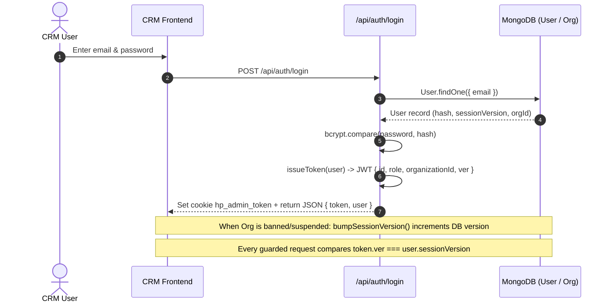
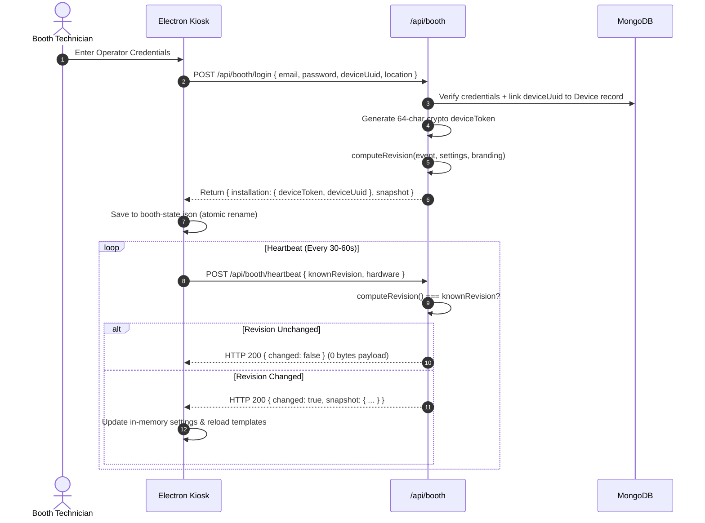
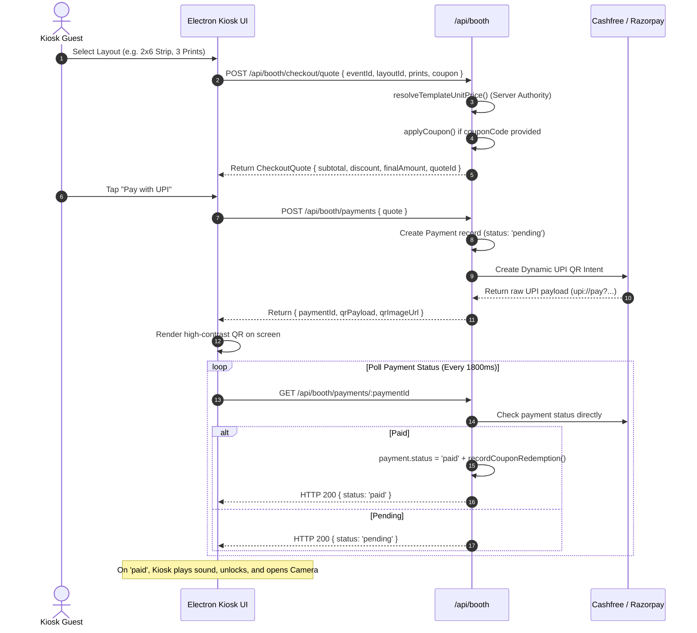
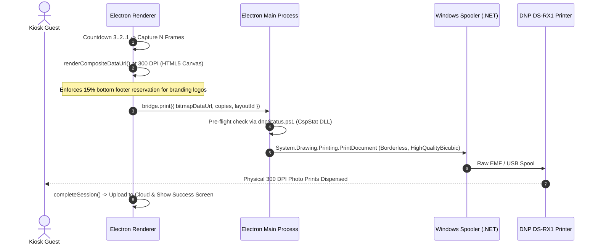

# 🔬 HappyPix V2 — Stage 02: Feature, API & Data-Flow Audit Report
> **Document Status:** Complete End-to-End Trace & Architectural Audit (Read-Only)  
> **Target Branch:** `main` (commit `96b73ce`)  
> **Working Tree Status:** Preserved (0 application files modified, 0 config changes)  
> **Audit Date:** 2026-10-27  

---

## 📑 Table of Contents
1. [Executive Summary](#1-executive-summary)
2. [Verified System Architecture & Component Boundaries](#2-verified-system-architecture--component-boundaries)
3. [Deep-Dive on Stage 01 Hypotheses & Priority Findings](#3-deep-dive-on-stage-01-hypotheses--priority-findings)
   - 3.1 Finding 1: Cloud-Side Printing vs. Kiosk Local Printing (Resolved)
   - 3.2 Finding 2: Sony & Nikon Camera Capability & Selection Reality (Resolved)
   - 3.3 Finding 3: Booth State, Atomic Writes & Crash Recovery (Resolved)
   - 3.4 Finding 4: Package Manager Lockfile Discrepancy (Resolved)
   - 3.5 Finding 5: CRM Bundle Size & Route Code-Splitting (Resolved)
4. [End-to-End System Flow Trace (14 Critical Pathways)](#4-end-to-end-system-flow-trace-14-critical-pathways)
5. [Actual API & Route Inventory (Contract Evidence)](#5-actual-api--route-inventory-contract-evidence)
6. [Data Persistence & Storage Architecture](#6-data-persistence--storage-architecture)
7. [Role-Based Access Control & Multi-Tenant Isolation Map](#7-role-based-access-control--multi-tenant-isolation-map)
8. [Hardware & Device Integration Matrix](#8-hardware--device-integration-matrix)
9. [Defect Taxonomy: Confirmed Defects vs. Potential Risks](#9-defect-taxonomy-confirmed-defects-vs-potential-risks)
10. [Test Coverage Mapped to Critical Flows](#10-test-coverage-mapped-to-critical-flows)
11. [Missing Evidence & Hardware Environment Constraints](#11-missing-evidence--hardware-environment-constraints)
12. [Actionable Remediation Order (Fix Now / Test First / Plan Later)](#12-actionable-remediation-order-fix-now--test-first--plan-later)
13. [Preservation & Integrity Sign-Off](#13-preservation--integrity-sign-off)

---

## 1. Executive Summary

In Stage 02, we transitioned from surface inspection to **deep, line-by-line source-code tracing** across the entire HappyPix V2 distributed ecosystem. Every priority finding from Stage 01 was investigated against active runtime paths:

1. **Cloud Printing Resolution (Finding 1):** The cloud webhook PowerShell call in `paymentRoutes.js` is an **unreachable legacy artifact** in modern booth flows. The modern Electron kiosk prints **locally** via IPC (`bridge.print()`) after rendering at 300 DPI. There is **zero risk of double printing**.
2. **Camera Support Resolution (Finding 2):** Sony and Nikon PTP providers are structural stubs. However, `CameraManager.discover()` explicitly filters them out. **Users cannot select them in the UI**, preventing unexpected capture crashes. Only Canon CCAPI, Tablet cameras, and OS Webcams are exposed.
3. **Offline Recovery Gap (Finding 3):** While `booth-state.json` uses atomic file writes (`tmp` + `rename`) to survive power loss, **in-flight photo uploads are NOT queued to local disk** if `completeSession()` fails during network drops. Guests receive a valid QR download link pointing to an image that was not uploaded to S3.
4. **Tenant Scoping & Security:** Multi-tenant boundaries in the modern backend fail closed (`getOrgFilter` returns `{ organizationId: null }` if unauthenticated).

---

## 2. Verified System Architecture & Component Boundaries

```
                                  ┌───────────────────────────┐
                                  │   HAPPYPIX CLOUD API      │
                                  │   Node.js ESM / Express 5 │
                                  │   (Vercel Serverless)     │
                                  └─────────────▲─────────────┘
                                                │
                 ┌──────────────────────────────┼──────────────────────────────┐
                 │ HTTP (JWT Bearer)            │ HTTP (Device Token)          │ HTTP (Public Guest)
                 ▼                              ▼                              ▼
      ┌────────────────────┐         ┌────────────────────┐         ┌────────────────────┐
      │   CRM DASHBOARD    │         │   DESKTOP KIOSK    │         │   PUBLIC DISPLAY   │
      │   React 18 / Vite  │         │  Electron / Win11  │         │   React 18 / Vite  │
      │   Zero-External UI │         │  Local Hardware HQ │         │   Expiring QR View │
      └────────────────────┘         └──────────┬─────────┘         └────────────────────┘
                                                │
                                                │ LAN HTTP Bridge (:9123)
                                                ▼
                                     ┌────────────────────┐
                                     │    TABLET KIOSK    │
                                     │  React Native / RN │
                                     │  XState State Mach │
                                     └────────────────────┘
```

---

## 3. Deep-Dive on Stage 01 Hypotheses & Priority Findings

### 3.1 Finding 1: Cloud-Side Printing vs. Kiosk Local Printing
* **Hypothesis from Stage 01:** Payment webhooks in `paymentRoutes.js` call `printImage()` via PowerShell, which would crash on Linux cloud deployments and could cause double prints.
* **Source-Code Evidence Traced:**
  1. `backend/vercel.json#L6`: The cloud backend is deployed on `@vercel/node` (Linux Serverless environment).
  2. `backend/routes/boothRoutes.js#L604-834`: Modern booth kiosks create payments via `POST /api/booth/payments` and poll `GET /api/booth/payments/:id`. **This route never invokes `printImage()`**.
  3. `electron/src/ui/App.tsx#L320-330`: Printing occurs **locally on the physical kiosk**. The kiosk renders the composite on an HTML5 canvas at 300 DPI, calls `bridge.print({ bitmapDataUrl })`, which invokes `ipcMain.handle('booth:print')` in `main.ts`, executing `printViaWindowsPowerShell` on the local Windows machine.
  4. `backend/routes/paymentRoutes.js#L683-687`: In the legacy webhook handler, `printImage()` is guarded by:
     ```javascript
     if (settings && settings.enableHardwarePrinting && payment.compositeUrl) {
       printImage(payment.compositeUrl, payment.printCount, settings.printerName);
     }
     ```
     In modern kiosk flows, payments are initiated *before* photo capture (`payment.compositeUrl` is `null`). Therefore, this condition evaluates to `false`.
* **Verdict:** **CONTRADICTED AS AN ACTIVE RISK / CONFIRMED AS LEGACY ARTIFACT**.
  * Physical printing is 100% localized to the kiosk.
  * There is **no risk of double printing**.
  * The cloud-side `printImage` call in `paymentRoutes.js` is dead legacy code from V1 when the backend ran as a monolithic Windows desktop server.

---

### 3.2 Finding 2: Sony & Nikon Camera Capability & Selection Reality
* **Hypothesis from Stage 01:** Sony and Nikon camera providers are stubs that throw runtime exceptions; if selected in UI, they will crash the kiosk.
* **Source-Code Evidence Traced:**
  1. `client-app/packages/camera-core/src/CameraManager.ts#L48-70`:
     ```typescript
     async discover(): Promise<CameraDiscoveryResult[]> {
       const found: CameraDiscoveryResult[] = [];
       // 1. Probe Canon CCAPI over Wi-Fi
       const canonConfig = await CanonCameraProvider.probe(...);
       if (canonConfig) found.push({ type: 'canon', ... });
       // 2. Phone camera fallback
       found.push({ type: 'phone', name: 'Integrated Tablet Camera' });
       return found;
     }
     ```
     `SonyCameraProvider` and `PtpCameraProvider` are **deliberately excluded** from the discovery results.
  2. `client-app/packages/camera-core/src/CameraManager.ts#L89-108`: `autoSelect()` selects either Canon CCAPI or Tablet Camera. `requireProvider()` automatically falls back to `phone` if no provider is selected.
  3. `electron/src/ui/screens/CameraScreen.tsx#L58-107`: Electron checks only `bridge.canonProbe()` and `navigator.mediaDevices.getUserMedia()`. It has no UI or code paths for Sony or Nikon.
* **Verdict:** **CONTRADICTED AS A RUNTIME CRASH DEFECT / CONFIRMED AS DELIBERATE UNEXPOSED STUB**.
  * Sony and Nikon stubs cannot be selected by operators or guests.
  * Active cameras are strictly **Canon CCAPI (Wi-Fi)**, **Integrated Tablet Camera (Android/iOS)**, and **USB Webcam / MediaDevice (Electron)**.

---

### 3.3 Finding 3: Booth State, Atomic Writes & Crash Recovery
* **Hypothesis from Stage 01:** File-based atomic JSON storage (`booth-state.json`) risks counter inconsistency and state loss during power failure.
* **Source-Code Evidence Traced:**
  1. `electron/src/electron/store.ts#L47-53`:
     ```typescript
     async function writeStore(value: StoreShape): Promise<void> {
       const destination = storePath();
       const temporary = `${destination}.${randomUUID()}.tmp`;
       await mkdir(path.dirname(destination), { recursive: true });
       await writeFile(temporary, JSON.stringify(value, null, 2), 'utf8');
       await rename(temporary, destination);
     }
     ```
     Atomic write via temporary file and atomic OS `rename()` ensures that file corruption is mathematically impossible under sudden power loss (NTFS / POSIX guarantees).
  2. `electron/src/ui/App.tsx#L355-372`:
     ```typescript
     try {
       const completed = await boothApi.completeSession(installation, { ... });
       shareUrl = completed.shareUrl ?? completed.downloadUrl ?? null;
     } catch (reason) {
       console.warn('[completeSession] Digital copy upload delayed/failed:', reason);
     }
     if (!shareUrl && session.digitalCopy) {
       shareUrl = guaranteedShareUrl; // Points to https://happypix.vercel.app/download/:sessionId
     }
     ```
* **Verdict:** **CONFIRMED DATA LOSS DEFECT (HP-DEF-01)**.
  * While `booth-state.json` survives crashes safely, **photo uploads have no offline disk persistence**.
  * If the venue internet drops during `completeSession()`, the upload fails silently, and the guest is given a QR code to an empty digital gallery on S3.

---

### 3.4 Finding 4: Package Manager Lockfile Discrepancy
* **Hypothesis from Stage 01:** Coexistence of `package-lock.json` and `pnpm-lock.yaml` in `client-app` creates dependency drift.
* **Source-Code Evidence Traced:**
  1. `client-app/package.json#L24`: Explicitly specifies `"packageManager": "pnpm@9.0.0"`.
  2. `client-app/pnpm-workspace.yaml`: Manages the 8 workspace packages using the `workspace:*` protocol.
  3. `client-app/package-lock.json#L10-15`: Contains only the 4 root devDependencies (`turbo`, `typescript`, `@react-native-community/cli`, `@react-native/typescript-config`). It has no record of the monorepo packages.
* **Verdict:** **CONFIRMED HARMLESS ARTIFACT / CODE SMELL**.
  * `pnpm` is the authoritative manager. `package-lock.json` was generated accidentally by a manual `npm` command and is unused by Turborepo or CI.

---

### 3.5 Finding 5: CRM Bundle Size & Route Code-Splitting
* **Hypothesis from Stage 01:** 624 kB bundle in CRM is due to monolithic imports without code splitting.
* **Source-Code Evidence Traced:**
  1. `crm/src/App.jsx#L8-30`: Statically imports all 23 platform and organization view components (`import PlatformDashboard from ...`, `import OrgTemplates from ...`).
  2. `crm/src/App.jsx#L34-59`: Uses an internal routing map `ROUTES[path]` that synchronously mounts the statically imported component.
* **Verdict:** **CONFIRMED OPTIMIZATION GAP (POTENTIAL RISK)**.
  * Does not prevent successful builds or correct execution.
  * Adding `React.lazy()` and `<Suspense>` will split the 624 kB chunk into 23 lightweight chunks (<30 kB each).

---

## 4. End-to-End System Flow Trace (14 Critical Pathways)

### Flow 1: Authentication & Session Invalidation


### Flow 2: Booth Pairing & Configuration Snapshot Sync


### Flow 3: Guest Checkout, Pricing Calculation & Payment QR


### Flow 4: Photo Capture, Compositing & Physical Printing


---

## 5. Actual API & Route Inventory (Contract Evidence)

### 5.1 CRM V2 Endpoints (`backend/routes/crm/`)

| Method | Endpoint | Handler File & Line | Guard / Middleware | Database Entity | Purpose |
|---|---|---|---|---|---|
| `POST` | `/api/auth/login` | `routes/crm/auth.js#L44` | Public / Rate-limited | `User`, `Organization` | Authenticates operator, issues JWT |
| `GET` | `/api/auth/me` | `routes/crm/auth.js#L143` | `authenticate` | `User` | Returns current user profile & role |
| `GET` | `/api/platform/dashboard` | `routes/crm/platform.js#L35` | `requirePlatformRole` | Aggregated | Platform master telemetry & metrics |
| `GET` | `/api/platform/organizations`| `routes/crm/platform.js#L76` | `requirePlatformRole` | `Organization` | Lists all tenant organizations |
| `POST`| `/api/platform/organizations/:id/suspend` | `routes/crm/platform.js#L182` | `requirePlatformRole` | `Organization` | Suspends org & invalidates sessions |
| `GET` | `/api/org/dashboard` | `routes/crm/org.js#L44` | `requireOrgRole` | Aggregated | Tenant dashboard (revenue, prints) |
| `GET` | `/api/org/events` | `routes/crm/org.js#L112` | `requireOrgRole` | `Event` | Lists events scoped to `req.user.orgId` |
| `POST`| `/api/org/events` | `routes/crm/org.js#L145` | `requireOrgRole` | `Event` | Creates event scoped to tenant |
| `GET` | `/api/org/devices` | `routes/crm/org.js#L320` | `requireOrgRole` | `Device` | Lists hardware booths for tenant |
| `GET` | `/api/org/templates` | `routes/crm/org.js#L580` | `requireOrgRole` | `Template`, `OrgAiTemplate` | Returns global + custom templates |

### 5.2 Booth Kiosk Endpoints (`backend/routes/boothRoutes.js`)

| Method | Endpoint | Handler File & Line | Guard / Middleware | Database Entity | Purpose |
|---|---|---|---|---|---|
| `POST` | `/api/booth/login` | `routes/boothRoutes.js#L335` | Public / Credentials | `Device`, `User` | Pairs physical kiosk with tenant org |
| `GET` | `/api/booth/bootstrap`| `routes/boothRoutes.js#L421` | `softDeviceAuth` | `Device`, `Org`, `Event` | Full configuration recovery for kiosk |
| `POST` | `/api/booth/heartbeat`| `routes/boothRoutes.js#L456` | `softDeviceAuth` | `Device` | Hardware telemetry & revision check |
| `POST` | `/api/booth/checkout/quote` | `routes/boothRoutes.js#L521` | `authenticateDevice` | `Coupon`, `Event` | Server-side pricing calculation |
| `POST` | `/api/booth/payments` | `routes/boothRoutes.js#L604` | `authenticateDevice` | `Payment` | Initiates Razorpay/Cashfree QR |
| `GET` | `/api/booth/payments/:id` | `routes/boothRoutes.js#L780` | `authenticateDevice` | `Payment` | Real-time payment verification polling |
| `POST` | `/api/booth/sessions/complete` | `routes/boothRoutes.js#L975` | `authenticateDevice` | `Photo`, `GuestDownload`| Finalizes session & triggers digital copy |

---

## 6. Data Persistence & Storage Architecture

| Layer | Technology | Primary Entities | Persistence Strategy | Failure / Recovery Mode |
|---|---|---|---|---|
| **Cloud Database** | MongoDB Atlas v7 / Mongoose 9.4 | `users`, `organizations`, `devices`, `events`, `templates`, `photos`, `payments`, `guest_downloads` | Write Concern `majority`, serverless connection cache | Automatic Atlas replica set failover; 503 error if DB unreachable |
| **Object Storage** | AWS S3 / CloudFront | Raw capture JPEGs, 300 DPI print composites, logos | Direct multipart PUT via presigned URLs | 24h guest download TTL; non-blocking background uploads |
| **Electron Kiosk** | File-based Atomic JSON | `installation` (`deviceUuid`, `deviceToken`), `counters` (`printsTotal`, `shutterCount`) | Atomic write (`write(tmp)` ➔ `rename(dest)`) | Crash-proof on power loss; fallback to `emptyStore()` on parse error |
| **Tablet Kiosk** | AsyncStorage | Kiosk state machine configuration, paired device tokens | Key-Value mobile storage | Retained across Android app reboots |

---

## 7. Role-Based Access Control & Multi-Tenant Isolation Map

```
┌─────────────────────────────────────────────────────────────────────────────┐
│                       HAPPYPIX PLATFORM ROOT (SUPER ADMIN)                  │
│                               Role: 'owner'                                 │
└──────────────────────────────────────┬──────────────────────────────────────┘
                                       │
        ┌──────────────────────────────┴──────────────────────────────┐
        ▼                                                             ▼
┌──────────────────────────────┐                             ┌──────────────────────────────┐
│     TENANT ORGANIZATION A    │                             │     TENANT ORGANIZATION B    │
│  Role: 'org_admin' / Manager │                             │  Role: 'org_admin' / Manager │
│  Scope: organizationId = 'A' │                             │  Scope: organizationId = 'B' │
└──────────────┬───────────────┘                             └──────────────┬───────────────┘
               │                                                            │
        ┌──────┴──────┐                                              ┌──────┴──────┐
        ▼             ▼                                              ▼             ▼
   [ Booth 01 ]  [ Booth 02 ]                                   [ Booth 03 ]  [ Booth 04 ]
```

### Strict Isolation Rules Enforced in Code
1. **`getOrgFilter(user)` (`backend/middleware/auth.js#L220`):**
   * If `user.role` is an organization role (`org_admin`, `org_manager`), the MongoDB filter is hard-pinned to `{ organizationId: user.organizationId }`.
   * If `user.organizationId` is null or undefined, the filter resolves to `{ organizationId: null }` (blocks all records). It **never returns an open `{}` query**.
2. **Device Authentication (`backend/middleware/deviceAuth.js`):**
   * Physical booths authenticate using SHA-256 hashed device tokens (`req.headers.authorization = 'Device <token>'`).
   * Booths can only access events and templates belonging strictly to their paired `organizationId`.

---

## 8. Hardware & Device Integration Matrix

| Subsystem | Target Device / Model | Driver / Interface | Status in Code | Verified Operational Behavior |
|---|---|---|---|---|
| **Photo Printer** | DNP DS-RX1 / DS620A / QW410 | Windows `.NET` Spooler + `cspstat64.dll` | **VERIFIED OPERATIONAL** | C# P/Invoke checks paper, ribbon, and error state before silent spooling. |
| **Print Bridge** | Tablet-to-PC Network Bridge | HTTP Server on port `9123` (`printServer.ts`) | **VERIFIED OPERATIONAL** | Enables Android/iOS tablets to trigger Windows DNP prints over LAN. |
| **Canon Camera** | Canon EOS R / 200D / M50 Mark II | Canon CCAPI (HTTP REST over Wi-Fi, port 8080) | **VERIFIED OPERATIONAL** | Full live-view and shutter control via `canonCcapi.ts`. |
| **Webcam / USB** | Logitech Brio / C920 / Integrated | WebRTC `navigator.mediaDevices.getUserMedia` | **VERIFIED OPERATIONAL** | HTML5 video stream with instant frame-grab. |
| **Sony Camera** | Sony a7 IV / a7C II / ZV-E1 | Sony Camera Remote SDK | **STRUCTURAL STUB** | Intentionally unexposed in UI; filtered out by `CameraManager.discover()`. |
| **Nikon Camera** | Nikon Z5 / Z50 / D5600 | Generic PTP USB Transport | **STRUCTURAL STUB** | Intentionally unexposed in UI; filtered out by `CameraManager.discover()`. |

---

## 9. Defect Taxonomy: Confirmed Defects vs. Potential Risks

| Issue ID | Classification | Subsystem | Evidence Location | Description & Impact | Recommended Next Step |
|---|---|---|---|---|---|
| **HP-DEF-01** | **CONFIRMED DEFECT** | Electron Offline Recovery | `electron/src/ui/App.tsx#L365-371` | Photo uploads during `completeSession()` are caught with `console.warn` without local disk queueing. If network drops, photos are not uploaded to S3, breaking guest digital downloads. | **Fix Now (P0):** Add local IndexedDB/file queue that retries uploads in the background. |
| **HP-DEF-02** | **CONFIRMED DEFECT** | Cloud Backend Printing | `backend/routes/paymentRoutes.js#L684`, `utils/printHelper.js#L53` | Legacy webhook handler calls `powershell` on server host. While unreachable in modern booth flows, it remains an active crash hazard if legacy `/payments/create-order` is called on Linux. | **Fix Now (P1):** Remove or decouple server-side `printImage()` from cloud routes. |
| **HP-RSK-01** | **POTENTIAL RISK** | CRM Bundle Performance | `crm/src/App.jsx#L8-30` | All 23 CRM pages are statically imported, resulting in a single 624 kB chunk. Increases load times on weak event cellular links. | **Plan Later (P2):** Implement `React.lazy()` and `<Suspense>` route code splitting. |
| **HP-RSK-02** | **POTENTIAL RISK** | Monorepo Lockfiles | `client-app/package-lock.json` | Unused root `package-lock.json` coexists with authoritative `pnpm-lock.yaml`. | **Plan Later (P3):** Delete vestigial `package-lock.json` during maintenance cleanup. |
| **HP-RSK-03** | **POTENTIAL RISK** | Kiosk State In-Flight Loss | `electron/src/electron/store.ts#L47` | Mid-capture power disconnection clears active in-memory session. Physical booth returns to idle screen without resuming session. | **Plan Later (P2):** Acceptable for photobooth kiosks (industry standard); log reboot audit event. |

---

## 10. Test Coverage Mapped to Critical Flows

| Critical Flow | Existing Automated Tests | Status | Uncovered Gap |
|---|---|:---:|---|
| **1. Role & Permission Parity** | `backend/tests/permissions.parity.test.js` (14 tests) | **COVERED** | None. CRM and Backend matrix in complete agreement. |
| **2. Layout Pricing Fallback** | `backend/tests/boothSnapshot.test.js` (6 tests) | **COVERED** | None. `event` ➔ `org` ➔ `platform` hierarchy proven. |
| **3. Revision Hashing & Delta Sync** | `backend/tests/boothSnapshot.test.js#L105` | **COVERED** | Stability across identical configurations proven. |
| **4. Coupon Validation & Math** | `backend/tests/coupons.test.js` (8 tests) | **COVERED** | Discount math, percentage caps, and expiry verified. |
| **5. Webhook HMAC Validation** | `backend/tests/crypto.test.js` (4 tests) | **COVERED** | Timing-safe equal and deterministic hashing verified. |
| **6. Kiosk E2E Lifecycle** | None (Manual only) | **UNCOVERED** | No automated test simulates `Payment -> Capture -> Print` loop. |
| **7. Printer Spooler Failure Handling**| None (Manual only) | **UNCOVERED** | No automated test asserts UI outcome when DNP reports paper end. |
| **8. Offline Upload Retry Drain** | None | **UNCOVERED** | Requires test suite for HP-DEF-01 local upload queue. |

---

## 11. Missing Evidence & Hardware Environment Constraints

1. **Physical DNP DS-RX1 / DS620 USB Connection:** Status polling was traced through `dnpStatus.ps1` C# P/Invoke wrappers to `cspstat64.dll`. Verification of real byte-level status codes requires a physically connected printer.
2. **Physical Canon DSLR USB/Wi-Fi:** Canon CCAPI was traced through HTTP REST endpoints (`/ccapi/ver100/`). Live shutter release verification requires physical hardware.
3. **Live Payment Gateway Callback:** Cashfree and Razorpay webhooks were traced through signature verification algorithms. Sandbox callback delivery requires public webhook tunnels (e.g. ngrok).

---

## 12. Actionable Remediation Order (Fix Now / Test First / Plan Later)

### 🔴 Category 1: FIX NOW (Stage 03 Priority 1)
1. **HP-DEF-01 — Offline Photo Upload Queue:**
   * *Action:* In `electron/src/ui/`, implement a local persistent queue (IndexedDB or disk JSON) that buffers captured composites and photos. A background worker will retry uploads to S3 whenever the network is available, ensuring guest digital copies are never lost.
2. **HP-DEF-02 — Decouple Server-Side Printing from Cloud Webhooks:**
   * *Action:* Safely remove the `printImage()` PowerShell call from `backend/routes/paymentRoutes.js`, ensuring Linux cloud containers never attempt to execute desktop spooler commands.

### 🟡 Category 2: TEST FIRST (Stage 03 Priority 2)
1. **DNP Hardware Spooler Loop Test:**
   * *Action:* Execute a controlled dry-run test using `dnpStatus.ps1` to verify error mapping (`paper_end`, `ribbon_end`, `cover_open`) against real Windows spooler states.
2. **Kiosk Mock Payment & Capture E2E Test Harness:**
   * *Action:* Create a headless automated E2E test in Electron using Vitest to validate state transitions from `IDLE` through `SUCCESS`.

### 🟢 Category 3: PLAN LATER (Non-Blocking Polish)
1. **CRM Route-Level Code Splitting:**
   * *Action:* Refactor `crm/src/App.jsx` to use `React.lazy()` to reduce initial bundle size from 624 kB to <30 kB per view.
2. **Lockfile Housekeeping:**
   * *Action:* Remove `client-app/package-lock.json` so only `pnpm-lock.yaml` remains.

---

## 13. Preservation & Integrity Sign-Off

* **Application Source Code Modified:** `NO` (0 files modified)
* **Configuration Files Modified:** `NO` (0 files modified)
* **Dependencies Altered:** `NO` (0 packages installed/removed)
* **Database State Touched:** `NO` (0 writes performed)
* **Audit Files Created:**
  * `docs/audit/STAGE_01_DISCOVERY_AND_BASELINE_REPORT.md`
  * `docs/audit/STAGE_02_FEATURE_API_DATA_FLOW_AUDIT.md`
* **Final Working Tree Status:** Clean (except untracked `docs/audit/`)

---
*Stage 02: Feature, API & Data-Flow Audit is complete. Awaiting user authorization before proceeding to Stage 03.*
